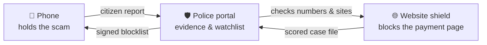
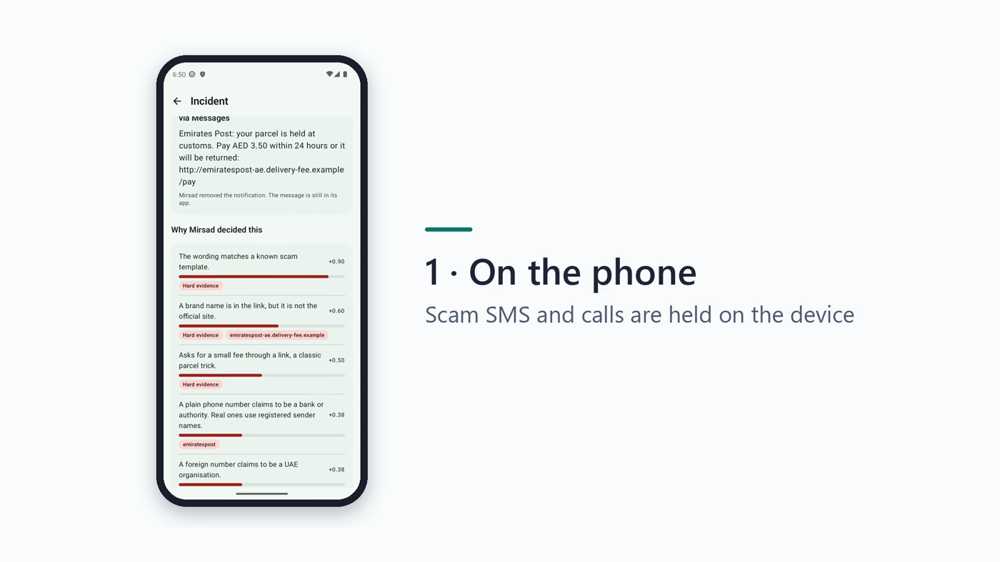
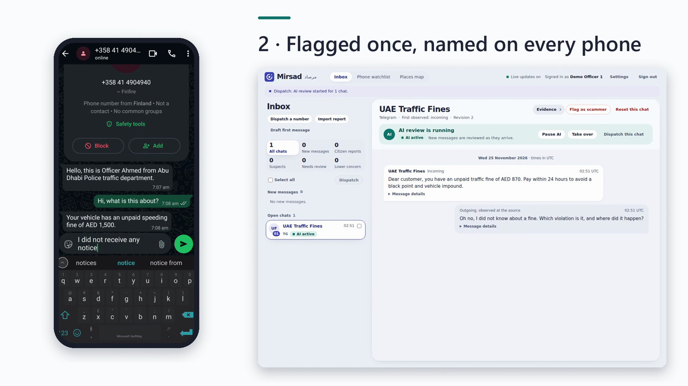
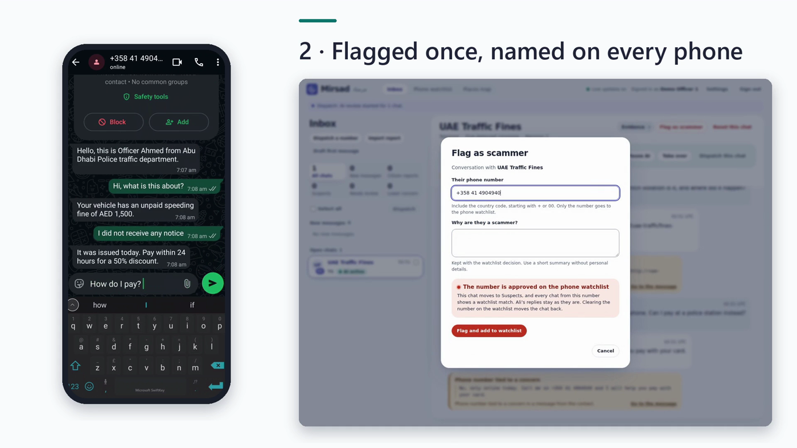
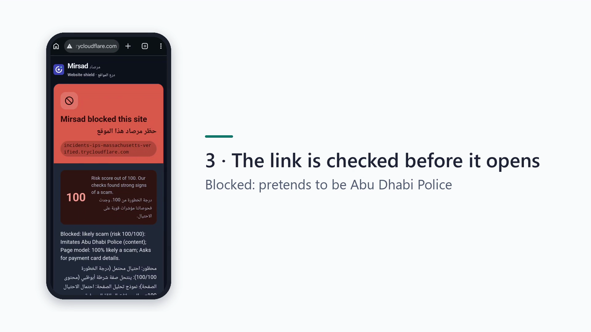
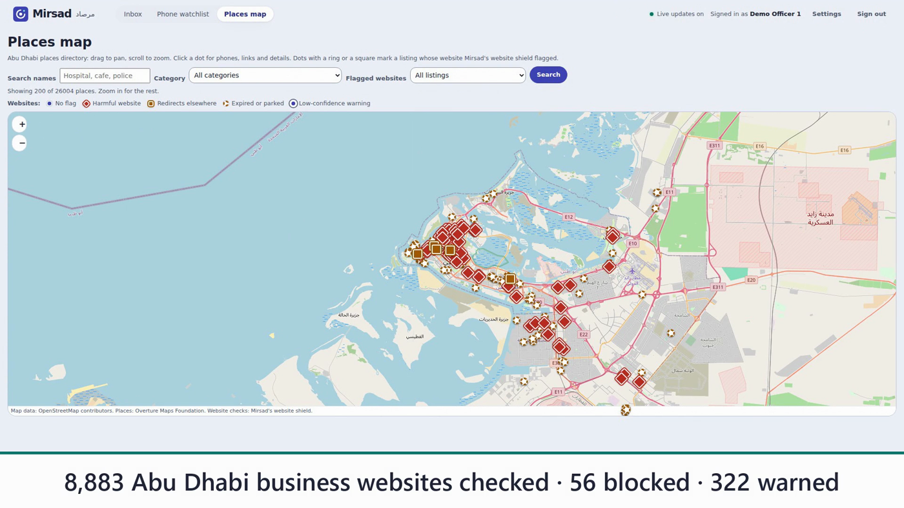
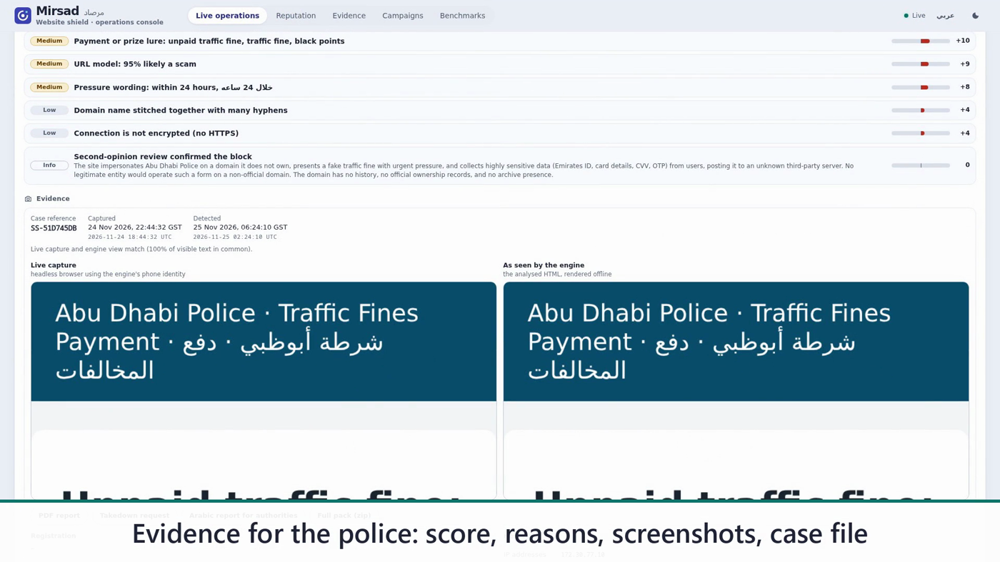

# Mirsad · مرصاد

**Three layers of protection against fraud — the phone, the police, and every link in between.**

Built for the Abu Dhabi Police hackathon by team **Ctrl + Alt + Cats**

[**Live portal**](https://mirsad.catsdoes.team/) ·
[**Android APK**](mirsad-android/dist/mirsad-android-debug.apk) ·
[**15-second demo**](mirsad-android/demo/mirsad-explainer-15s.mp4) ·
[**Service guide**](SERVICE-GUIDE.md)

A scam needs three things to succeed: a victim who answers, a number nobody recognises, and a payment page that works.
Mirsad takes all three away — and each layer feeds the next:

## 1 · On the phone

An on-device shield with **no internet permission**. Scam SMS are held before they are seen, calls from block-listed
numbers are rejected before they ring, every decision is explained in Arabic or English — and nothing is ever deleted.
One tap turns an attempt into an evidence report for the police.

## 2 · The police

The [officer portal](https://mirsad.catsdoes.team/) records every message as timestamped, SHA-256-verified evidence.
**Ali**, Mirsad's AI, keeps a suspected scammer talking — links are flagged while the chat continues, and the instant
bank details appear, Ali freezes and hands over to an officer. *The scammer types the evidence himself.*
One click flags the number, and the signed blocklist flows back to every phone.

| Ali works the chat, live | Flagged once, named on every phone |
|---|---|
|  |  |

## 3 · Every link

Links are checked **before they open**: a fake Abu Dhabi Police payment page is blocked with a scored, bilingual
explanation. The same engine sweeps at city scale — cross-checked against ~26,000 real Abu Dhabi business listings,
because scammers borrow real shops' names and numbers. Every block becomes a ready case file.

| Blocked before it opens | The whole city, checked | Evidence for the police |
|---|---|---|
|  |  |  |

## Try it

- **Judges' 2-minute route:** install the [APK](mirsad-android/dist/mirsad-android-debug.apk) → tap **Demo** (no
  permissions needed), then open the [live portal](https://mirsad.catsdoes.team/) and the
  [awareness campaigns](https://mirsad.catsdoes.team/assets/awareness.html) page.
- **Run the portal locally:** `npm ci && npm run demo:walkthrough -- --reviewer deterministic` — a full 22-check officer
  workflow on synthetic fixtures, no credentials or model needed. Details in the [service guide](SERVICE-GUIDE.md).

## The numbers

| | |
|---|---|
| On-device message analysis | milliseconds, offline, on the phone |
| AI evidence extraction (held-out set) | 87% precision · 95% recall · 242 ms median |
| Automated verification | 1,090 tests + 37 real-browser dashboard flows passing |
| Abu Dhabi website sweep | 8,883 business sites checked · 56 blocked · 322 warned |

Everything in this repository uses synthetic data; what is live, simulated, or pending approval is stated plainly in
the [service guide](SERVICE-GUIDE.md#what-is-simulated-and-what-needs-a-host-integration).
The model never labels fraud — it extracts, code decides, and an officer always has the last word.

**Ctrl + Alt + Cats** · Mirsad (مرصاد) — *for fraud, lying in wait.*

