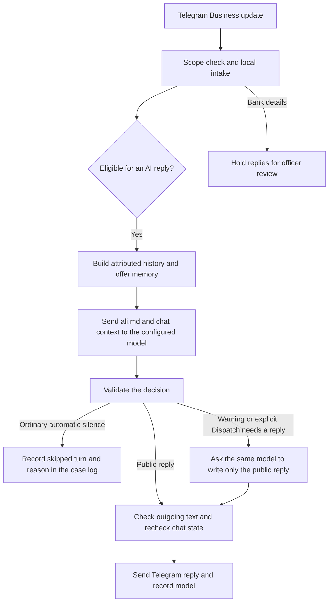

# Editing Ali's live Telegram replies

**The file to edit for conversation rules is `prompts/ali.md`.** It contains Ali’s role, English and Emirati Arabic style, buyer and seller behavior, stopping rules, and officer handoff criteria. The first system message contains the file on every production turn, including a retry. Gemini, Cydonia and the local LM Studio adapter use the same contract. Mirsad reads the saved file at startup and when an officer chooses **Settings → Reload Ali’s prompt**.

For normal use, the approved contact sends a message in Telegram. There is no test prefix or command. An officer sees a handoff in Mirsad’s dashboard and can open the original chat message. The model supplies a decision. The application owns delivery and officer controls.

## Follow one incoming message



1. **Intake.** `src/adapters/telegram/live-connector.ts` scopes the incoming update, normalizes it and calls `ingest` in `src/services/intake.ts`. The local store tracks source messages, edits and deletions. Replayed updates are deduplicated.
   With all-DM replies and **Test mode** on, a fresh eligible private message from the contact or the human account owner automatically activates new and returning chats. If the owner sends the opener, the worker waits for an incoming DM. It checks participant permission before building model context. Switching **Test mode** off in Settings stops automatic Dispatch and invitations for new contacts. Authorized active chats can continue.
2. **Eligibility.** `openSession`, `claim` and `waiting` in `src/workers/ai-reply-worker.ts` check account binding, participant permission, officer control, contact identity and freshness. In either mode, manual **Dispatch** confirms each selected participant already agreed to AI replies and fraud screening in that chat, including sending eligible messages to Gemini through OpenRouter when configured. Each eligible chat immediately gets a reply request, retry or follow-up without a permission invitation. Existing approvals and receipts for previously delivered invitations remain valid. Ordinary replies have a fifteen-minute freshness window. Queued manual requests expire when the contact’s 24-hour window closes. For an approved original attachment without a caption, Dispatch can ask the model to request text using only the verified attachment type and eligible chat context. Later automatic replies wait for three quiet seconds so consecutive messages form one turn. Opt-outs, pauses, takeover and active holds apply.
3. **Context.** `historyFor` selects up to 32 eligible recent messages and applies their latest source edits. The full eligible history supports guard and race checks. The model-facing history additionally excludes attributable, unedited previous AI replies that wrongly claimed to sell or disclose details. The source record remains intact.
4. **Generation.** `aiReplyWorkerFor` in `src/app.ts` selects the configured adapter. `buildReplyMessages` constructs the request. The worker uses `decide` to collect a public reply, silence decision or private assessment. When a warning needs a public reply, `composePublicReply` asks the same model to write it using the same Ali prompt version and eligible conversation. This request accepts only the public reply field. The text-only compatibility method `generate` still maps silence and handoff to `null`.
5. **Dispatch.** The worker checks a public draft with `blockedRuleForTurn` and checks for an already answered identity question. An explicit Dispatch can request model-written wording after a silence decision. If generation fails or the model cannot produce a usable draft, the worker records the outcome and sends nothing for that turn. A delivered conversational reply records the authoring model. The worker checks the source, controls and holds again before sending through Telegram Business. The receipt shows **Sent** once Telegram confirms the send.
6. **Officer warnings.** A validated conversation assessment can accompany a safe public reply. The private report records the source event, risk indicators and model. Officers can inspect it and choose **Mark reviewed** in the dashboard. Bank-recipient details independently hold replies until an officer reviews them.

Link warnings can accompany a public reply. The officer can acknowledge a warning while Ali is drafting or sending.
Reviewing a link clears repeat warnings for that destination in the same chat episode. Reviewing a conversation
assessment also clears repeats of the same status and indicators within that chat episode. A newly supplied bank
account or IBAN pauses replies for officer review.

## What belongs in each file

| Owner | Responsibility |
| --- | --- |
| `prompts/ali.md` | All model-facing conversation and assessment rules. Change wording, dialect, examples and the ordinary review threshold here. |
| `src/replies/ali-prompt.ts` | Load the exact file and validate its numeric header. A malformed header fails startup. |
| `src/replies/reply-generator.ts` | Adapter interface, message roles, context budget, history construction, shared error and detector exports, and the loopback LM Studio adapter. |
| `src/replies/reply-context.ts` | Recognize language, identity questions, explicit offers, corrections, withdrawals and contextual guard cases. These classifications support routing, memory and safety checks. |
| `src/workers/offer-memory.ts` | Rebuild the sender’s latest explicit offer and correction from eligible SQLite rows, including offers older than the recent window. |
| `src/replies/ali-decision.ts` | Provider JSON schema, local validation, and conversion to the internal reply/silence/review type. Changes to field names or allowed reason codes must also update the prompt, adapters, tests and officer display. |
| `src/replies/reply-errors.ts` | Shared fixed failure codes carried by `ReplyGenerationError`. Provider diagnostics and message text stay out of logs. |
| `src/replies/openrouter-reply-generator.ts` | Fixed OpenRouter endpoint, model and provider allowlists, cancellation, timeout, completion validation and sanitized errors. The Gemini compatibility wrapper is in `gemini-reply-generator.ts`. |
| `src/replies/reply-guard.ts`, `reply-guard-rules.ts`, `reply-duplicates.ts` | Outbound privacy and action checks, fixed rule codes and repeated-identity suppression. The application enforces these even if a draft ignores the prompt. |
| `src/workers/ai-reply-worker.ts`, `src/services/telegram-reply-holds.ts`, `src/services/officer.ts` | Claim work, perform final checks, send, persist, queue a review, and resolve it under officer control. |
| `src/dashboard/js/views/`, `src/dashboard/js/format.js` | Display officer reports, readable indicator labels and pointers to the original source. |

## The generator contract in detail

`ReplyTurn` contains `from` and `text`. Map `contact` to the model’s `user` role and `owner` to its `assistant` role. An outgoing message may have been written by an officer or a previous model. `ReplyOfferMemory` contains the sender’s original offer and optional latest correction. Always preserve who supplied a statement when the contact switches languages.

The adapter methods accept `history, signal, correction?, currentTurn?, memory?, investigation?, prompt?`. Keep the cancellation signal connected through the network request. `currentTurn` identifies the latest incoming burst, including multiple short messages. The builder can insert a model-only silence marker between an earlier unanswered burst and a later burst. Adjacent messages from the same speaker are joined. A guard retry carries a fixed code alongside context. Neither sender text nor remembered excerpts belong in the system message.

`historyCharsFor`, `fitTurn` and `recentTurns` bound the amount of history leaving the worker. The default range is 500–8,000 UTF-16 units, even with a hosted model that has a much larger context window. Older turns are capped at 1,500 units each. The most recent incoming text can use 3,000, keeping both ends when clipped so a late correction survives. The builder returns the retained turns oldest first. It masks project-name mentions in its inference copy and strips a historical assistant introduction from prior outgoing turns. It never rewrites the evidence.

`OfferMemory.read` uses source positions, edits, deletion state, enrollment and evidence exclusions. The sender’s explicit correction can update an offer and a withdrawal clears it. On restart the cache can be rebuilt from eligible sources. The builder includes missing excerpts as quoted user data if they fit within the memory budget. A model cannot infer forgotten, withdrawn or excluded facts merely by selecting a larger context window.

`createLmStudioReplyGenerator` permits HTTP(S) on the loopback hosts only, rejects redirects and combines timeout and caller cancellation. It can check the returned local model ID when language routing uses different local models. Explicit custom prompts used by evaluation tools can use legacy plain text and the exact `[NO_REPLY]` marker. Production Ali calls use the structured decision. `cleanReply` is a text utility. Production responses must pass the parser for the requested output format and the worker’s outgoing checks.

## Decision and threshold

The wire fields are `case_status`, `should_reply`, `external_reply`, `review_reasons`, `silence_reason` and `silence_explanation`. When the model chooses silence it selects one specific `silence_reason` (there is no catch-all code) and writes `silence_explanation`, one sentence telling the officer why. `officerSilenceExplanation` masks links, addresses, handles and long numbers in it and limits its length before it is stored with the skipped turn; logs keep only the code. If a silence arrives without an explanation, the worker asks the model once more and otherwise keeps the code alone. The application-supplied instructions in `buildReplyMessages` define each code. Public replies and officer handoffs use `null` for both fields. Only validated `external_reply` text is eligible for the chat. The application rejects malformed JSON, extra fields, oversized or internally formatted public text, inconsistent flags and invalid reason codes.

| Model status | Effect |
| --- | --- |
| `MONITORING` or `SUSPICIOUS` | A public reply or a reason for silence. The list of handoff reasons is empty. |
| `INSUFFICIENT_FRAUD_INDICATORS` | Silence on this exchange. |
| `READY_FOR_OFFICER_REVIEW` | A private warning followed by public reply generation. Requires distinct ordinary indicator codes meeting `minimum_distinct_indicators` in the prompt header. Allowed threshold values are 2, 3 and 4. |
| `HUMAN_INTERVENTION_REQUIRED` | An immediate private warning followed by public reply generation. Requires an urgent reason such as a threat, a sensitive request or unresolved material uncertainty. |

A bookcase offer can get an ordinary buyer response. An unexplained advance fee and independently stated pressure to pay can justify review. Repeating one demand is one fact. The parser can enforce unique codes. The model judges whether the underlying facts are independent, and the officer checks the source. A report requests human review and makes no finding of guilt. Among evidence categories, only detected bank-recipient details hold a chat for officer review. Contact opt-outs and officer controls also apply before delivery.

With the default threshold, the following decision records an officer warning. The worker then asks the model for a public reply to the same exchange.

```json
{
  "case_status": "READY_FOR_OFFICER_REVIEW",
  "should_reply": false,
  "external_reply": null,
  "review_reasons": ["upfront_fee", "payment_pressure"],
  "silence_reason": null,
  "silence_explanation": null
}
```

The other ordinary codes are `contradictory_terms` and `unverified_payment_request`. The immediate-review codes are `sensitive_request`, `threat` and `uncertain`. The code list is part of the API contract. The prompt explains what each code means. Model-generated names, bank details, timestamps, free-form accusations and quotations have no field in this report. The officer can inspect the locally recorded source and surrounding timeline.

## How to change and verify it

For a wording or threshold edit, change `prompts/ali.md`. Keep the header and wire field names intact. Keep tests synthetic, and use only IDs, codes and counts in operational logs. Credentials are held in the ignored environment and data files.

For a new decision or review reason, update the prompt, parser, structured schema, worker handling, dashboard labels and contract tests together. For memory changes, test both language directions, a source correction or deletion, a withdrawal, and a restart. For delivery changes, test a hold or takeover arriving while inference is in flight. Store model-generated indicators alongside links to locally recorded source events. The local store supplies the actual IDs and timestamps.

| Developer verification | What it exercises |
| --- | --- |
| `npm run typecheck` and `npm test` | Type contracts, message construction, output parsing, memory, guards, provider adapters and worker integration. |
| `tests/integration/telegram-conversation-review.test.ts` | Warning on an eligible chat, source attribution and public reply generation. |
| `npm run test:e2e` | Officer dashboard behavior in a browser. |
| `npm run openrouter:verify` and `npm run prompt:preview` | Invented exchanges through the hosted adapter. These tools do not send Telegram messages. |

After saving an edit, click **Settings → Reload Ali’s prompt**. The new wording and review threshold take effect together on the next model turn. A turn already in progress, including a correction attempt, keeps its original version. If the saved file is unreadable or the header is invalid, the current version stays active. Fix the file and click the button again.

In an approved, AI-active Telegram chat, an ordinary message uses the live path directly. If no reply appears, check the officer queue, contact consent, AI mode and case-action outcome before changing the prompt. Legitimate silence, review, a blocked draft, and provider failure are different outcomes.

A temporary wording test can relax length, repetition, language and follow-up wording checks for a single explicitly approved chat. At launch the service accepts a process-level deadline up to fifteen minutes ahead. The deadline is checked during drafting and again before sending a draft that could cross the cutoff. Consent, officer handoffs, financial and identity information checks, and the structured output contract apply throughout.
