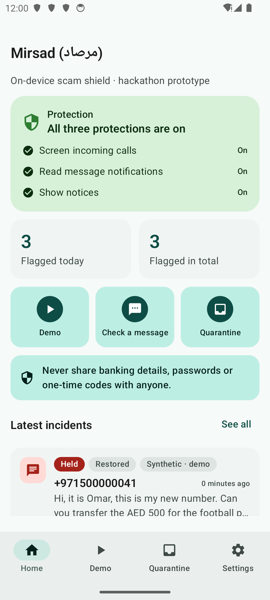
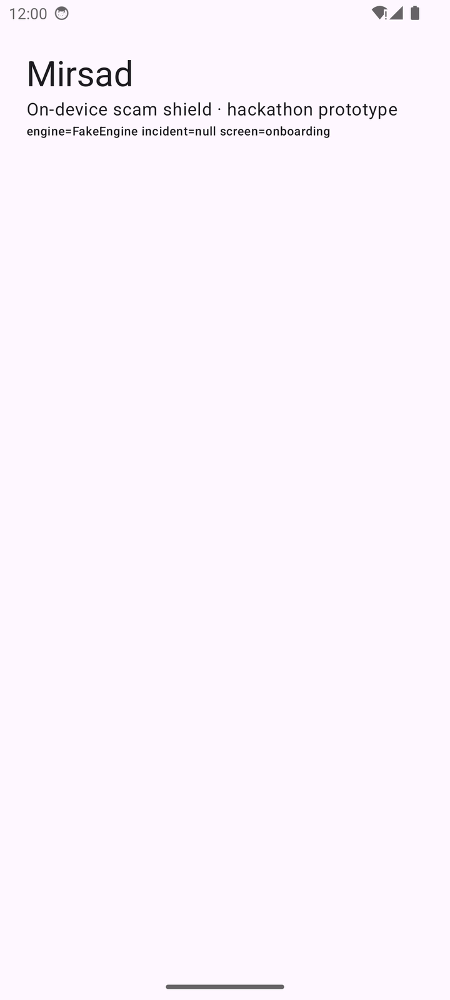
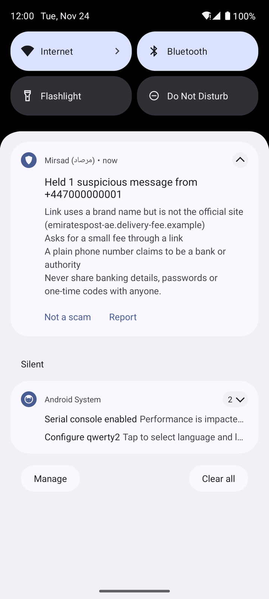
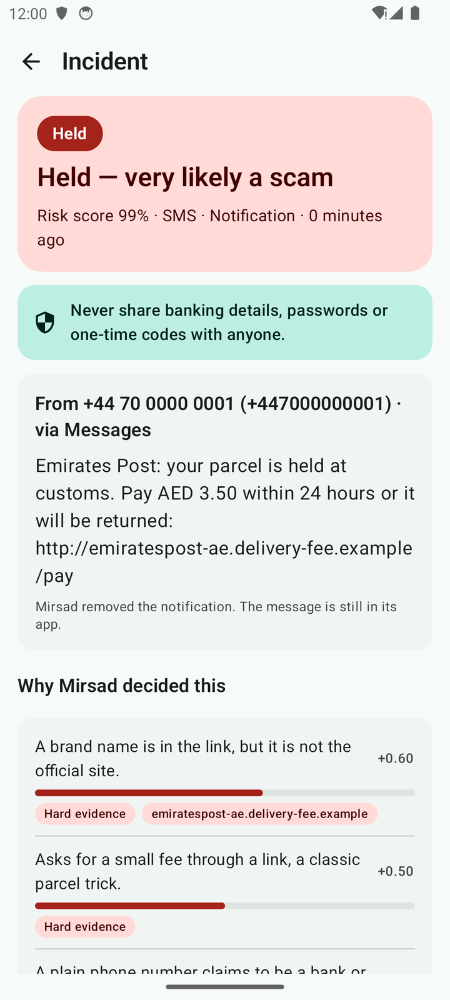
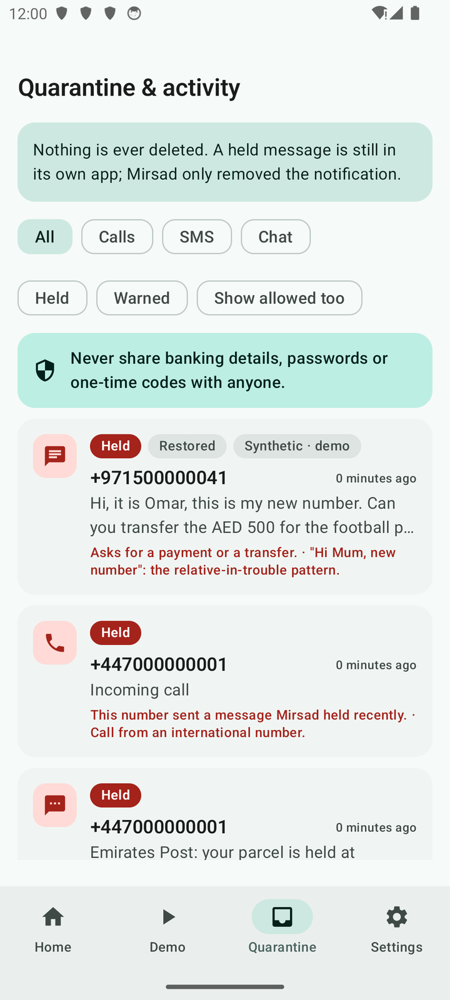
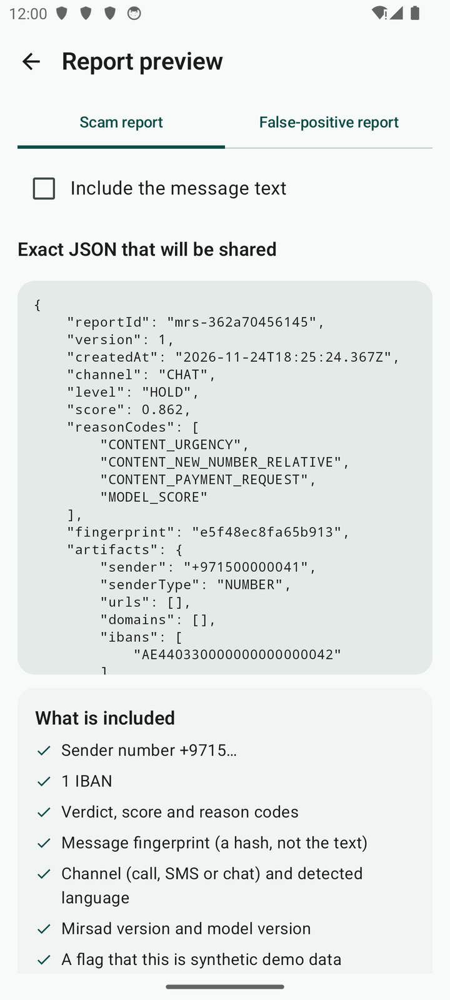
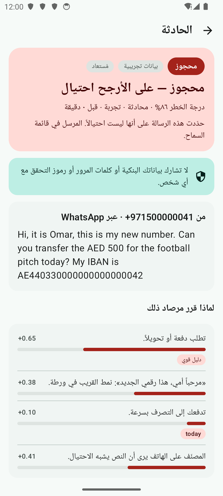
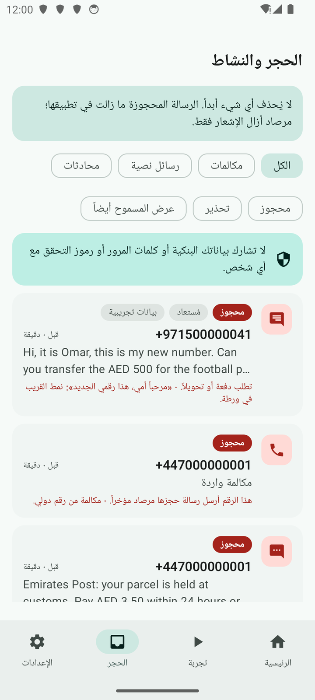

# Mirsad Android (مرصاد)

Mirsad Android is an on-device scam shield for people in the UAE: it decides on the phone whether an incoming call or
message is a scam, holds or flags it, explains why in Arabic or English, lets you overrule it in one tap, and turns each
attempt into a structured evidence packet you can choose to send to the police. It is a hackathon prototype for the
Abu Dhabi Police hackathon by the Mirsad team, not an official app, and it holds no internet permission.


20-second video: [English captions](demo/mirsad-android-demo.mp4) · [Arabic captions](demo/mirsad-android-demo-ar.mp4)
· voice-over script in [docs/VOICEOVER.md](docs/VOICEOVER.md). Every phone frame is a real screen from the APK in
`dist/` on an Android 14 emulator: the scam SMS and the call are injected through the emulator and go through the real
notification listener and call screening service ("without Mirsad" is the same SMS with Mirsad's access switched off).

15-second explainer: [demo/mirsad-explainer-15s.mp4](demo/mirsad-explainer-15s.mp4). It was recorded on a real
Android 15 phone, including a real scam call from a block-listed number rejected before it rang (the caller's
number is pixelated).

## 1. Try it in two minutes

**Install** `dist/mirsad-android-debug.apk` (Android 10 or newer, debug-signed).

- With adb: `adb install -r dist/mirsad-android-debug.apk`
- On the phone: copy the APK over, open it from **Files**, allow installs from that source when asked, tap **Install**.

**See it work without granting anything:**

1. Open Mirsad, tap **Skip** on the first screen, then **Demo**. Tap a sample scam: it is analysed on the phone, held,
   and the incident screen shows the verdict, the reasons, the evidence and "Analysed on this phone in N ms".
2. Still in Demo, tap **A real message Mirsad gets wrong** (a friend with a new number asking to be paid back). It is
   held. Tap **Not a scam**: one tap restores it, allows the sender and remembers the template, with **Undo**. Tap the
   sample again: it is no longer held.
3. On any incident, tap **Report**: the preview shows the exact JSON that would be shared and what is never included.
4. In any messaging app, long-press a message, tap **Share** and choose **Check with Mirsad**. The verdict opens.

**Optional: live protection.** Onboarding (or Settings > Permissions) walks through three switches, all revocable:

| Protects | What Android calls it |
|---|---|
| Messages from Google Messages and other SMS apps, WhatsApp, WhatsApp Business, Telegram, Botim | Notification access |
| Calls from numbers not in your contacts | Call screening role ("Caller ID & spam app") |
| Mirsad's own notices (Android 13+) | Notifications permission |

**Sideloaded APK:** Android 13+ greys out notification access for apps installed from a file until you open
**Settings > Apps > Mirsad > ⋮ > Allow restricted settings**. This is an Android rule, not a Mirsad quirk.

Tested on Android 14 and Android 16 emulators: an injected scam SMS is held and a call from the same number is rejected
on both.

## 2. What it does

<table>
  <tr>
    <td align="center"><br>Home</td>
    <td align="center"><br>Onboarding</td>
    <td align="center"><br>Demo</td>
    <td align="center"><br>Held notice</td>
  </tr>
  <tr>
    <td align="center"><br>Incident</td>
    <td align="center"><br>Quarantine (one item restored)</td>
    <td align="center"><br>Report preview</td>
    <td align="center"><br>Home in Arabic</td>
  </tr>
  <tr>
    <td align="center"><br>Demo in Arabic</td>
    <td align="center"><br>Incident in Arabic</td>
    <td align="center"><br>Quarantine in Arabic</td>
    <td></td>
  </tr>
</table>

Every call and message gets one of three levels:

| Level | Message | Call |
|---|---|---|
| **ALLOW** | Nothing happens, and nothing is stored. | Nothing happens. |
| **WARN** | The original notification stays. Mirsad adds a caution with the reasons and the safety line. | The phone rings, with a heads-up warning. |
| **HOLD** | Mirsad removes the original notification, keeps a copy in **Quarantine**, and posts a quiet notice (no sound) "Held 1 suspicious message from <sender>" with **Not a scam** and **Report**. | The call is rejected before the phone rings, stays in the call log, and a notice says why. |

Screens: **Onboarding**, **Home** (protection status, counts for today and in total, latest incidents), **Quarantine &
Activity** (held and warned items with reasons, filters by channel and level, 30-day retention), **Incident**,
**Report preview**, **Demo**, **Settings** (language, sensitivity, monitored apps, allow and block lists, blocklist
import, export of your corrections, delete all data).

Every warning, in both languages, carries the Abu Dhabi Police public guidance line:
*"Never share banking details, passwords or one-time codes with anyone."* /
*"لا تشارك بياناتك البنكية أو كلمات المرور أو رموز التحقق مع أي شخص."*

## 3. How detection works

Everything runs on the phone in pure Kotlin (`core/`, no Android imports), in one call that never throws.

**Stage 1: rules and reputation** (data in `app/src/main/assets/rules.json`, version 1.2.0):
- *Sender*: block and allow lists; a plain mobile number that claims to be a bank, courier, telecom or government body;
  a non-UAE country code while the text names a UAE entity; international and one-ring call patterns; a call from a
  number that sent a held message in the last 7 days.
- *Links*: every URL is extracted and checked for shorteners, IP hosts, punycode or mixed-script hosts, plain http,
  high-risk TLDs, lookalikes of official domains (small edit distance) and a brand name in a host that is not the
  official domain.
- *Content*, after Arabic normalisation (diacritics and tatweel stripped, alef, ya and ta marbuta unified,
  Arabic-Indic digits mapped): urgency, threats, requests for a one-time code, PIN, CVV, card number, Emirates ID or
  UAE Pass approval, a small fee behind a link, prizes, daily-pay jobs, guaranteed returns, remote-access apps, a move to
  WhatsApp or Telegram, payment requests with an IBAN or wallet, "a relative with a new number". "Do not share this
  code" is recognised as advice, not a request.

**Stage 2: classifier.** Hashed character 2–5-grams plus word unigrams, logistic regression with L2, trained by the
Kotlin task `./gradlew :core:trainModel` (no Python) on 1,400 synthetic rows. The model file is 1 MB.

**One score, then the HOLD gate.** Both stages combine into one score in [0, 1]. Thresholds (warn / hold): Relaxed
0.60 / 0.80, Balanced 0.45 / 0.65 (default), Strict 0.35 / 0.55. **HOLD also needs at least one hard signal**:

- a lookalike link, a brand name in a non-official link host, or a blocklisted domain;
- a blocklisted sender or message fingerprint (these hold at every sensitivity);
- a request for credentials or a one-time code;
- a request for payment: to an IBAN or wallet from an unknown number with something that corroborates it (pressure, a
  "new number" story, impersonation, a foreign number), or a small fee behind a link with a named entity, a foreign
  number, a deceptive link or a threat;
- a request to install a remote-access app; a job or investment offer that sends you to a non-official link;
- for calls only: a number that sent a held message in the last 7 days.

The classifier can raise a WARN on its own, but never a HOLD.

**Evidence and fingerprint.** The engine extracts phone numbers (E.164, default region AE), URLs and registrable
domains, IBANs (mod-97 checked for AE), e-mail addresses, crypto wallets and wa.me / t.me handles. Each text gets a
64-bit SimHash over the normalised text with digits and URLs masked, so variants of one campaign share a fingerprint.

**Speed.** On a laptop JVM the engine's median is about 2 ms per message (`core` latency test: p50 2.0 ms, p95 3.6 ms).
On the Android emulators it logged 0–10 ms per message, with one first message after start at 175 ms. Only the first
2,000 characters of a text are analysed, which bounds the worst case: adversarial inputs from the verification below
take under 0.4 s.

Details: [docs/ARCHITECTURE.md](docs/ARCHITECTURE.md). Try the same engine on a laptop without a phone:

```sh
scripts/analyse.sh "+447000000001" "Emirates Post: your parcel is held. Pay AED 3.50 within 24 hours: http://emiratespost-ae.delivery-fee.example/pay"
```

## 4. When Mirsad is wrong: the false-positive flow

A wrongly held message must cost one tap and nothing else.

- **Nothing is ever deleted.** A held message is still in its own app; Mirsad only removed the notification. A held call
  is still in the call log. The Quarantine screen says this in plain words.
- **Never silent.** Every HOLD posts a notice with **Not a scam** and **Report**. If Mirsad cannot post notices
  (permission or notifications turned off), it does not hold: the original notification stays and the call rings.
- **Not a scam** (on the notice or the incident screen) does five things: marks the incident as a false positive; adds
  the sender to the allow list; adds the message fingerprint to a known-good list so the same template is not held
  again; posts a normal notification with the original sender and text that opens the source app; shows a confirmation
  with **Undo**.
- **Never HOLD**: a sender that looks like a saved contact (WARN at most), anything on the allow list, a one-time code
  from a sender ID with no link, a notification whose content the system has hidden.
- **Calls are held only on hard evidence** (a blocklisted number, or a number that sent a held message in the last 7
  days). Everything else at most rings with a warning.
- **Sensitivity** moves the thresholds; it never removes the evidence requirement or the never-HOLD rules.
- **Your corrections stay on the phone** as labelled rows. Settings > *Export my corrections as training rows* shares
  them as CSV in the training-data format, only when you choose to.
- **The build gate**: `data/legit_suite.csv` holds 56 legitimate UAE-style messages (bank codes, delivery updates,
  utility bills, appointment reminders, marketing, government notices, family chat in Arabic and English). The test
  fails if any is held or more than two are warned; today 0 are held and 0 warned. Two more sets from the independent
  verification (one-time codes from sender IDs, and bank and police fraud-awareness texts that say "do not share")
  must never be held either. These tests run before every app build.

Full policy: [docs/FALSE_POSITIVES.md](docs/FALSE_POSITIVES.md).

## 5. What gets reported, and what never is

Nothing leaves the phone unless you tap **Report**, look at the preview, and pick an app in the Android share sheet.
There is no background upload. Scam report, version 1:

| Field | Content |
|---|---|
| `reportId`, `version`, `createdAt` | Stable id (`mrs-` + 12 hex, a hash of the incident, not of the device), schema version 1, ISO-8601 UTC time |
| `channel`, `level`, `score` | CALL / SMS / CHAT; ALLOW / WARN / HOLD; combined score |
| `reasonCodes` | Stable codes such as `LINK_BRAND_IN_HOST_NOT_OFFICIAL`, `CONTENT_SMALL_FEE_LINK` |
| `fingerprint` | 64-bit SimHash of the normalised, masked text (16 hex characters) |
| `artifacts.sender`, `artifacts.senderType` | Sender number (E.164) or sender ID; a saved contact's name is never included |
| `artifacts.urls`, `domains`, `ibans`, `emails`, `wallets`, `handles`, `phones` | Evidence extracted from the message |
| `language`, `appVersion`, `modelVersion`, `synthetic` | Detected language, build and model; `true` for Demo incidents |
| `text` | **Only** when you tick *Include the message text* on the preview screen |

**Never included:** your contacts, any other message, your location, device identifiers, your own phone number.

A **false-positive report** carries the fingerprint, reason codes, sender type, model version and your verdict (and the
text only if ticked).

**Report to Abu Dhabi Police (Aman).** The report preview offers *Call 8002626*, *SMS 2828* and *Email
aman@adpolice.gov.ae*. They only open the dialer, an SMS draft or an e-mail draft with a short bilingual summary that
never contains the message text; you press send. They are **disabled for Demo and synthetic incidents**, with a note
saying why, so no test data reaches a real police line. The channel details, and Dubai Police eCrime (ecrime.ae) for a
later version, are in `app/src/main/assets/report_channels.json`, marked *to be confirmed with the police team*.

**Blocklist import.** Settings imports a JSON file of numbers, domains and fingerprints
(`app/src/main/assets/blocklist_example.json`). This is how a police alert reaches phones without the app going
online: the Mirsad portal's **Export blocklist** writes a list signed with the portal's key. A list signed by a key in
`app/src/main/assets/trusted_blocklist_keys.json` is shown as verified and replaces the previous list from that key,
so a number the police cleared disappears; a tampered, expired or unknown-key list is refused. An unsigned file is a
personal list. `scripts/trust_portal_key.sh` adds a portal's key before a build.

Schema details: [docs/EVIDENCE_SCHEMA.md](docs/EVIDENCE_SCHEMA.md).

## 6. Privacy: no internet permission, and how to verify it

Mirsad holds no `INTERNET` or `ACCESS_NETWORK_STATE` permission and contains no analytics, crash reporting, ads or
network code. The manifest strips both permissions if a library merges them in, and the Gradle task
`checkNoInternetDebug` fails the build if either survives in the merged manifest.

Verify the APK yourself (`aapt` is in the Android SDK build-tools):

```sh
aapt dump permissions dist/mirsad-android-debug.apk
```

Output for the current `dist/` APK:

```
package: app.mirsad.shield
uses-permission: name='android.permission.POST_NOTIFICATIONS'
permission: app.mirsad.shield.DYNAMIC_RECEIVER_NOT_EXPORTED_PERMISSION
uses-permission: name='app.mirsad.shield.DYNAMIC_RECEIVER_NOT_EXPORTED_PERMISSION'
```

The last two lines are a permission AndroidX declares for the app itself to keep its receivers private. Notification
access and the call-screening role are not manifest permissions: you grant and revoke them in system settings. Mirsad
never asks for contacts, SMS, call log or location.

What is stored, all in app-private storage: incidents Mirsad warned about or held (Quarantine, kept 30 days), Demo and
shared checks, the allow and block lists, your corrections, settings, and a copy of each report you shared. Messages and
calls that Mirsad allows are not stored at all. Backup and device-to-device transfer are disabled. Settings > *Delete all
data* removes everything, including report copies and Mirsad's notices.

## 7. Built for the UAE

- **Arabic and English everywhere**, right-to-left layout and an in-app language switch; numbers and links stay
  left-to-right inside Arabic text. The engine detects English, Arabic and Arabic written in Latin letters.
- **Local entities** with Arabic names and common spellings (`assets/lexicon.json`): Abu Dhabi Police, Dubai Police,
  Ministry of Interior, ICP, Emirates ID, UAE Pass, TAMM, Darb, Mawaqif, Salik, RTA, DEWA, ADDC, Emirates Post, Aramex,
  Central Bank of the UAE, FAB, ADCB, ADIB, Emirates NBD, Mashreq, Etisalat / e&, du.
- **Local formats**: +971 numbers, 05x mobiles, 02 landlines, 800 and 600 numbers, AED and dirham amounts, AE IBANs.
- **Local lures**: a parcel held for a three-dirham fee, an unpaid traffic or parking fine, a suspended card,
  "read out the one-time code", an Emirates ID or UAE Pass update, a prize, a daily-pay job, guaranteed returns, a
  remote-access app, a relative with a new number.
- **Reporting channels**: Abu Dhabi Police Aman shortcuts on every real incident (see section 5).
- **Official domains** (`assets/official_domains.json`) are a starter list marked *to be verified*.

## 8. How it fits with the other Mirsad products

The root of this repository is the **Mirsad portal**, where officers investigate scams. Mirsad Android is the
citizen-side counterpart, and the two exchange files, so the phone never needs the internet:

- **Phone to portal: citizen reports.** A report the citizen shares reaches an officer, who imports it with
  **Import report** in the portal (or a laptop runs the script below). It lands under **Citizen reports**, one chat
  per reported sender, with the phone's verdict, reasons and evidence; its numbers go to the phone watchlist for
  review. A report of a number the police already flagged shows as a watchlist match.

```sh
scripts/push_report_to_mirsad.sh --dry-run --file scripts/sample_report.json   # print the request body
export MIRSAD_OFFICER_TOKEN=...                                                # an officer's token, laptop only
scripts/push_report_to_mirsad.sh --file <report.json>                          # POST to $MIRSAD_BASE_URL/v1/citizen-reports
scripts/push_report_to_mirsad.sh [adb-serial]                                  # pull the newest report from the phone and send it
```

The field-by-field handling is in [docs/EVIDENCE_SCHEMA.md](docs/EVIDENCE_SCHEMA.md), section 7.

## 9. Build from source, tests, evaluation

Requirements: JDK 17 and the Android SDK with platform 37. The wrapper fetches Gradle 9.4.1; the build uses AGP 9.2.1,
Kotlin 2.4.21, Compose BOM 2026.09.00, Room 2.8.5, minSdk 29, compile and target SDK 37, debug signing only.

```sh
cd mirsad-android
./gradlew :core:test :app:assembleDebug :app:lintDebug
cp app/build/outputs/apk/debug/app-debug.apk dist/mirsad-android-debug.apk
```

- `:core:test` (114 tests) covers the engine, the HOLD gate policy, robustness, the classifier, the reports, signed
  blocklists and the
  legitimate-message sets. Every app build runs it first, and the no-internet check before packaging and lint.
- `./gradlew :core:trainModel` regenerates the synthetic data, evaluates, and writes `app/src/main/assets/model.bin`.
- `scripts/` holds the emulator, permission, injection, screenshot and video scripts used for the media here
  (`scripts/full_capture.sh` runs them all; the video is built by `scripts/make_explainer.py`).

**Classifier evaluation (synthetic data only)**, from `data/evaluation.md`: 1,400 rows (700 scam, 700 legitimate;
English, Arabic, Arabizi), 280 held out; precision 0.993, recall 1.000 at threshold 0.5. Variants of the same templates
are on both sides of the split, so this measures how well the model fits the templates, not real-world accuracy.

**Independent verification.** Verifiers who did not write the code wrote new messages and ran them through the engine
at Balanced sensitivity:

| Set | Rows | HOLD | WARN | ALLOW |
|---|---|---|---|---|
| New legitimate UAE-style messages | 289 | 1 | 54 | 234 |
| New scam messages, including evasion attempts | 232 | 91 | 97 | 44 |

Read these honestly: the rule fixes made tonight were tuned partly on the legitimate set, so its HOLD figure is
optimistic; the WARN rate on legitimate messages (19 %) is still too high, and 44 scams pass with no warning (mostly
text with no link, heavy obfuscation, or one-time-code requests phrased in dialect). Real, anonymised case data is the
next step for both.

## 10. Known limits and next steps

Platform limits:

- **Call screening sees the number and direction, not the audio**, and runs only for numbers not in your contacts.
- **A notification listener can remove another app's notification, not the message.** The message stays in its app.
- **Android 15+ hides one-time-code notifications from listeners.** Hidden content is treated as unavailable, never as
  a scam.
- **A sideloaded APK needs "Allow restricted settings"** before notification access can be granted.
- **WhatsApp and other internet calls cannot be screened.**
- Messages are watched in Google Messages, the AOSP and Samsung messaging apps, your default SMS app, WhatsApp,
  WhatsApp Business, Telegram and Botim; the list is editable in Settings.

Prototype limits: synthetic training data; starter lists of official domains and reporting channels; a single-word SMS
sender is treated as a sender ID, so a contact saved under one word can be held on hard evidence (one tap restores it);
debug-signed build with a debug-only demo autopilot that only adb can drive; tested on emulators.

Next steps: real, anonymised police case data for training and evaluation; lower the warning rate on legitimate
messages; Arabic dialect phrasings of one-time-code requests; verify the official domains and reporting channels with
the police team; a signed release build; an OTP guard during calls; an optional on-device explanation model behind an
interface (Liquid AI LFM2.5-350M via llama.cpp is the candidate).

## 11. ملخص بالعربية

مرصاد تطبيق أندرويد يقرّر على الهاتف نفسه إن كانت المكالمة أو الرسالة الواردة احتيالاً، فيحجزها أو يحذّر منها ويشرح السبب بالعربية أو الإنجليزية.
هو نموذج أولي لهاكاثون شرطة أبوظبي من فريق مرصاد، وليس تطبيقاً رسمياً.
لا يملك التطبيق صلاحية الإنترنت، فلا يخرج أي شيء من الهاتف إلا عندما تضغط «إبلاغ» وتختار بنفسك التطبيق الذي ترسل به.
ثلاثة مستويات: سماح (لا يحدث شيء)، تحذير (تبقى الرسالة ويُضاف تنبيه بالأسباب)، حجز (يُزال إشعار الرسالة وتُحفظ نسخة في الحجر، أو تُرفض المكالمة قبل أن يرنّ الهاتف).
الحجز يحتاج إلى دليل واضح، مثل رابط يقلّد جهة رسمية، أو مرسل أو رابط مدرج في قائمة الحظر، أو طلب رمز تحقق أو بيانات بنكية أو دفع. درجة النموذج وحدها لا تكفي للحجز.
لا يُحذف شيء أبداً؛ وإذا أخطأ مرصاد تضغط «ليس احتيالاً» مرة واحدة فتعود الرسالة ويُضاف المرسل إلى قائمة السماح، مع إمكانية التراجع.
يحوّل كل محاولة إلى بلاغ منظّم (JSON) يضم المرسل والروابط والنطاقات وأرقام الآيبان ورموز الأسباب، ولا يضم أبداً جهات الاتصال أو الموقع أو رقمك.
يفهم السياق الإماراتي: الجهات المحلية، أرقام ‎+971 و05x، الدرهم والآيبان الإماراتي، والحيل الشائعة كرسوم الطرود والمخالفات غير المدفوعة وطلب رموز التحقق.
جرّبه في دقيقتين: ثبّت ملف APK، وافتح «تجربة»، أو شارك أي رسالة مشبوهة إلى «افحص مع مرصاد».
وتذكّر دائماً: لا تشارك بياناتك البنكية أو كلمات المرور أو رموز التحقق مع أي شخص.
