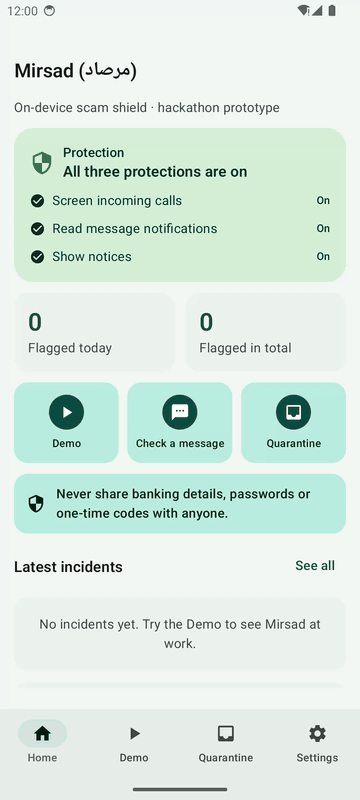
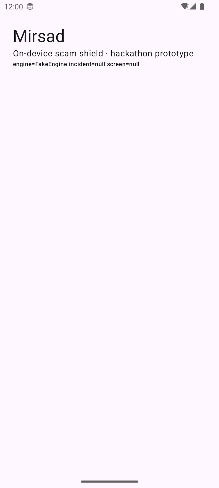
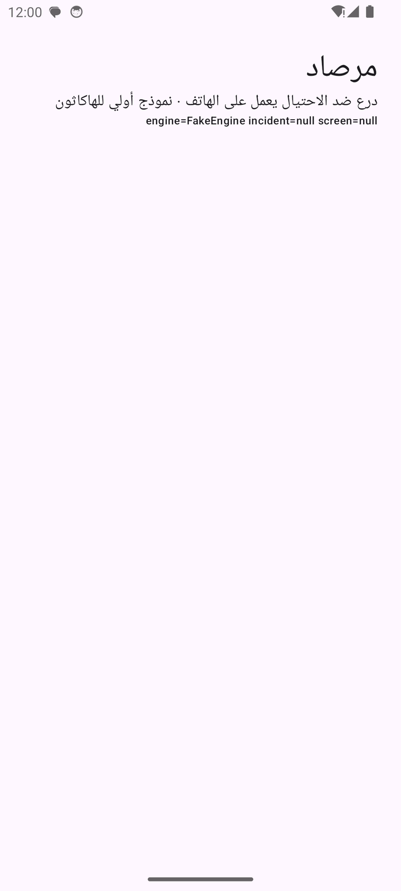

# Mirsad Android (مرصاد)

Mirsad Android is an on-device scam shield for people in the UAE: it decides on the phone whether an incoming call or
message is a scam, holds or flags it, explains why in Arabic or English, lets you overrule it in one tap, and turns each
attempt into a structured evidence packet you can choose to send to the police. It is a hackathon prototype for the
Abu Dhabi Police hackathon by the Mirsad team, not an official app.



Full-resolution video: [demo/mirsad-android-demo.mp4](demo/mirsad-android-demo.mp4)

## 1. Try it in two minutes

**Install** `dist/mirsad-android-debug.apk` (Android 10 or newer, debug-signed).

- With adb: `adb install -r dist/mirsad-android-debug.apk`
- On the phone: copy the APK to the phone, open it from **Files**, allow installs from that source when asked, tap
  **Install**. Nothing else is needed: the app has no internet permission and asks for nothing at install time.

**See a verdict** without granting any permission:

1. Open Mirsad and tap **Demo**. Pick a sample message or call; Mirsad shows the verdict, the score, the reasons and the
   time it took.
2. In any messaging app, long-press a message, tap **Share** and choose **Check with Mirsad**. The incident screen opens
   with the verdict for that text. This is the fastest thing to try on your own phone.

_Status: to confirm at M1 — Demo screen and share-target flow._

**Optional: live protection.** Mirsad needs two permissions, both granted in system settings and both revocable:

| Protects | Permission | Where |
|---|---|---|
| Messages (SMS, WhatsApp, WhatsApp Business, Telegram, Botim) | Notification access | Settings > Notifications > Device & app notifications (or Apps > Special app access > Notification access) > Mirsad |
| Calls | Call screening role ("Caller ID & spam app") | Onboarding asks for it; or Settings > Apps > Default apps > Caller ID & spam app > Mirsad |

Android 13 and newer also ask once to let Mirsad post its own notifications.

**Sideloaded APK hint.** On Android 13+, a sideloaded app cannot be given notification access until you open
**Settings > Apps > Mirsad**, tap the three-dot menu in the top right and choose **Allow restricted settings**. Then grant
notification access as above. This is an Android rule for all sideloaded apps, not a Mirsad quirk.

_Status: to confirm at M2 — onboarding, notification listener and call screening._

## 2. What it does

<table>
  <tr>
    <td align="center"><br>Home</td>
    <td align="center"><br>Onboarding</td>
    <td align="center"><br>Demo</td>
    <td align="center"><br>Held notice</td>
  </tr>
  <tr>
    <td align="center"><br>Incident</td>
    <td align="center"><br>Quarantine: Not a scam</td>
    <td align="center"><br>Report preview</td>
    <td align="center"><br>Home in Arabic</td>
  </tr>
</table>

Every call and message gets one of three levels:

| Level | Message | Call |
|---|---|---|
| **ALLOW** | Nothing happens. | Nothing happens. |
| **WARN** | The original notification stays. Mirsad adds a caution with the reasons and the safety line. | The phone rings with a heads-up warning. |
| **HOLD** | Mirsad removes the original notification, keeps a copy in **Quarantine**, and posts a quiet notice "Held 1 suspicious message from <sender>" with two actions: **Not a scam** and **Report**. | The call is rejected before the phone rings, stays in the call log, and a notice says why. |

Screens: **Onboarding** (what Mirsad does, the two optional permissions), **Home** (protection status, recent activity,
Check a message), **Quarantine & Activity** (held and warned items, 30-day retention), **Incident** (verdict, reasons in
plain language, artifacts, latency, Not a scam, Report), **Report preview** (the exact JSON before anything is shared),
**Demo** (synthetic samples, clearly marked), **Settings** (sensitivity, language, monitored apps, allow and block lists,
blocklist import).

Every warning, in both languages, carries the Abu Dhabi Police public guidance line:
*"Never share banking details, passwords or one-time codes with anyone."* /
*"لا تشارك بياناتك البنكية أو كلمات المرور أو رموز التحقق مع أي شخص."*

_Status: to confirm at M1 (Home, Demo, Incident, Quarantine, Report preview) and M2 (Onboarding, notices, calls)._

## 3. How detection works

Everything runs on the phone, in pure Kotlin, in one synchronous call that never throws. Target: median under 100 ms,
and the incident screen shows the real number for each verdict.

**Stage 1: rules and reputation.**
- *Sender rules*: blocklisted or allow-listed sender; a plain number claiming to be a bank or ministry; a foreign country
  code for a UAE entity; one-ring patterns; a number that appeared as sender in a held message in the last 7 days
  (the cross-channel call rule).
- *Link analysis*: URL shorteners, IP hosts, punycode or mixed-script hosts, plain HTTP, high-risk TLDs, a brand in a host
  that is not the official domain, and lookalikes of official UAE domains (government, telecom, banks, couriers).
- *Arabic normalisation*: alef and yaa variants, tatweel, diacritics, Arabic-Indic digits, and Arabic written in Latin
  letters, so the same lure is recognised however it is spelt.
- *Content signals for UAE lures*: urgency, threats, requests for credentials or one-time codes, a small fee behind a
  link, prizes, daily-pay jobs, guaranteed returns, remote-access apps, "move to WhatsApp/Telegram", payment requests,
  "I am your relative with a new number", impersonation of a local entity.

**Stage 2: classifier.** A hashed character n-gram plus word unigram logistic regression, trained by a Kotlin Gradle task
(`./gradlew :core:trainModel`) on synthetic data: seed rows plus generated variants, at least 400 rows, balanced,
English, Arabic and Arabizi, with 20 % held out. No Python, no network, no third-party ML library.

**Combination and the HOLD gate.** Stage 1 and Stage 2 produce one score in [0, 1]. The score alone can only reach WARN.
HOLD needs the score threshold **and** at least one hard signal: a lookalike or blocklisted link, a blocklisted sender or
fingerprint, or a request for credentials or payment. See [When Mirsad is wrong](#4-when-mirsad-is-wrong-the-false-positive-flow).

**Artifacts and fingerprint.** The engine extracts E.164 phone numbers, URLs and their registrable domains, UAE IBANs
(mod-97 checked), e-mail addresses, crypto wallets, and wa.me / t.me handles. Each text gets a 64-bit SimHash
fingerprint over the normalised text with digits and URLs masked, so the same scam campaign matches even when the
amount, the code or the link changes. Fingerprints, not texts, are what the block lists and reports carry.

Details: [docs/ARCHITECTURE.md](docs/ARCHITECTURE.md).

_Status: to confirm at M1 (Stage 1 engine) and M3 (classifier behind the gate)._

## 4. When Mirsad is wrong: the false-positive flow

A missed scam costs a warning. A wrongly held message costs trust. Mirsad is built so that a false positive costs the
user one tap and nothing else:

- **Nothing is ever deleted.** A held message is still in its own app; Mirsad only removed the notification and kept a
  copy. A held call is still in the call log.
- **Never silent.** Every HOLD posts a notice naming the sender.
- **Not a scam** does five things in one tap: marks the incident as a false positive, adds the sender to the allow list,
  adds the message fingerprint to a known-good list, posts a normal notification with the original sender and text that
  opens the source app, and shows a confirmation with **Undo**.
- **HOLD needs evidence** (the gate above). A classifier score on its own can only WARN.
- **Never HOLD** a sender that looks like a saved contact, anything on the allow list, a one-time code from an
  alphanumeric sender with no link, or content the system hid.
- **Calls are held only on hard evidence**: a blocklisted number, or a number that appeared in a held message in the
  last 7 days. A missed real call costs more than a missed real text.
- **Sensitivity** Relaxed / Balanced / Strict in Settings moves the score thresholds; it never removes the evidence
  requirement or the never-HOLD rules.
- **A legitimate-message suite** of 40+ UAE-style messages (bank OTPs, delivery updates, DEWA bills, school notices,
  Salik top-ups) gates every build: none may be held, at most two may be warned.
- Feedback stays on the phone and is exported with the training data so wrong verdicts become labelled rows.

Full policy: [docs/FALSE_POSITIVES.md](docs/FALSE_POSITIVES.md).

_Status: to confirm at M1 — Not a scam flow, Undo, legitimate suite in the build._

## 5. What gets reported, and what never is

Nothing leaves the phone unless you tap **Report** and then pick an app in the Android share sheet. The preview screen
shows the exact JSON and lists what is and is not included. Scam report, version 1:

| Field | Content |
|---|---|
| `reportId`, `version`, `createdAt` | Random id, schema version 1, ISO-8601 time |
| `channel`, `level`, `score` | CALL / SMS / CHAT; ALLOW / WARN / HOLD; combined score |
| `reasonCodes` | Stable codes such as `LINK_LOOKALIKE_OFFICIAL`, `CONTENT_CREDENTIAL_REQUEST` |
| `fingerprint` | 64-bit SimHash of the normalised, masked text (16 hex chars) |
| `artifacts.sender`, `artifacts.senderType` | The sender number or ID; NUMBER / ALPHANUMERIC / CONTACT / UNKNOWN |
| `artifacts.urls`, `artifacts.domains` | Links found and their registrable domains |
| `artifacts.ibans`, `artifacts.emails`, `artifacts.wallets`, `artifacts.handles`, `artifacts.phones` | Other extracted artifacts |
| `language` | EN / AR / LATIN_ARABIC / UNKNOWN |
| `appVersion`, `modelVersion`, `synthetic` | Build and model identifiers; `true` for Demo and test incidents |
| `text` | **Only** when you tick "include the message text" on the preview screen |

**Never included:** your contacts, any other message, your location, device identifiers, your own phone number, or
anything from apps other than the one incident.

A **false-positive report** carries only the fingerprint, reason codes, sender type, model version, your verdict and the
build identifiers (and the text, only if ticked), so wrong verdicts can improve the rules without exposing anyone.

**Reporting shortcuts.** The incident screen offers Abu Dhabi Police **Aman** (call 8002626, SMS 2828, e-mail
aman@adpolice.gov.ae) and Dubai Police **eCrime** (ecrime.ae). They open the dialer, an SMS draft or an e-mail draft
with a short bilingual summary; nothing is sent until you do it. They are **disabled for Demo and synthetic incidents**.
The channels are marked *to be confirmed with the police team* in `app/src/main/assets/report_channels.json`.

**Blocklist import.** Settings can import a JSON file of numbers, domains and fingerprints
(`app/src/main/assets/blocklist_example.json` shows the format). This is how a police alert could reach phones without
the app ever going online.

_Status: to confirm at M1 (report preview, share, Aman shortcuts) and M3 (blocklist import)._

## 6. Privacy: no internet permission, and how to verify it

Mirsad holds no `INTERNET` or `ACCESS_NETWORK_STATE` permission. There is no analytics, no crash reporting, no network
code and no foreground service. The manifest removes both permissions even if a library tries to merge them in, and the
Gradle task `checkNoInternetDebug` fails the build if either appears in the merged manifest.

Verify the APK yourself:

```sh
aapt dump permissions dist/mirsad-android-debug.apk
# or
apkanalyzer manifest permissions dist/mirsad-android-debug.apk
```

Expected output (checked against the current `dist/` APK):

```
uses-permission: name='android.permission.POST_NOTIFICATIONS'
uses-permission: name='android.permission.VIBRATE'
permission: app.mirsad.shield.DYNAMIC_RECEIVER_NOT_EXPORTED_PERMISSION
uses-permission: name='app.mirsad.shield.DYNAMIC_RECEIVER_NOT_EXPORTED_PERMISSION'
```

The last two lines are a permission the app declares for itself (AndroidX adds it to keep its own broadcast receivers
private); it grants nothing from the system. No `INTERNET`, no `ACCESS_NETWORK_STATE`, no contacts, no SMS, no
location. Notification access and the call-screening role are not manifest permissions; they are granted in system
settings and revoked there.

Data stays in the app's private Room database: incidents (Quarantine, 30-day retention), the allow and block lists, and
feedback. `allowBackup` is off. The only export paths are the share sheet, after you tap Report, and the Aman drafts.

## 7. Built for the UAE

- **Arabic and English everywhere**, right-to-left layout, an in-app language switch, and detection of English, Arabic
  and Arabic written in Latin letters.
- **A lexicon of local entities**: Abu Dhabi Police, Dubai Police, Ministry of Interior, ICP, Emirates ID, UAE Pass,
  TAMM, Darb, Mawaqif, Salik, RTA, DEWA, ADDC, Emirates Post, Aramex, Central Bank of the UAE, FAB, ADCB, ADIB, Emirates
  NBD, Mashreq, Etisalat/e&, du — so "your ADCB card is suspended" from a +44 number is read for what it is.
- **Local formats**: +971 and 05x numbers, 02 landlines, 800/600 service numbers, AED amounts, AE IBANs.
- **Local lures**: a parcel held for a three-dirham fee, an unpaid fine, a suspended card or account, "read out the
  one-time code", an Emirates ID or UAE Pass update, a prize, a daily-pay job, guaranteed returns, a remote-access app,
  a relative with a new number.
- **The official-domain list** (`app/src/main/assets/official_domains.json`) is a starter list marked *to be verified*;
  lookalike detection uses it as its reference.

_Status: to confirm at M3 — Arabic polish and lexicon coverage._

## 8. How it fits with the other Mirsad products

The root of this repository holds the **Mirsad service**: officer-side evidence capture and review for investigations,
with a dashboard, an HTTP API and an event stream. Mirsad Android is the citizen-side counterpart. The two meet at one
point: an exported Android report can be posted to the service's `POST /v1/ingest` route, which accepts an intake event
from a provisioned connector and creates or finds the matching chat. The phone never does this itself; a laptop-side
script does, with the connector token kept on the laptop:

```sh
scripts/push_report_to_mirsad.sh <report.json> http://127.0.0.1:8787
```

The field mapping from the Android report to the service's `IngestRequest` (source, external account and chat ids,
`message.recorded` event with sender and text) is documented in [docs/EVIDENCE_SCHEMA.md](docs/EVIDENCE_SCHEMA.md).
The result: a scam attempt that one phone held becomes a timestamped, reviewable item on an officer's screen, with the
same reason codes and artifacts the citizen saw.

_Status: to confirm at M1 — script and schema document (workstream E)._

## 9. Build from source, tests, evaluation

Requirements: JDK 17, Android SDK with platform 37. The Gradle wrapper fetches Gradle 9.4.1; the build uses AGP 9.2.1,
Kotlin 2.4.21, Compose BOM 2026.09.00, Room 2.8.5, minSdk 29, compile/target SDK 37, debug signing only.

```sh
cd mirsad-android
./gradlew :core:test :app:assembleDebug :app:lintDebug
cp app/build/outputs/apk/debug/app-debug.apk dist/mirsad-android-debug.apk
```

- `:core:test` runs the engine unit tests, the legitimate-message suite, the classifier tests and the report tests.
  `:core` is pure Kotlin with no Android imports, so everything that decides runs on the JVM in tests.
- `:app:assembleDebug` and `:app:lintDebug` both depend on `checkNoInternetDebug`.
- `./gradlew :core:trainModel` retrains the Stage 2 model from `data/` and writes `app/src/main/assets/model.bin`.
- JSON assets live in `app/src/main/assets/` and are exposed to `:core` as classpath resources, so tests read the same
  files the APK ships.

**Evaluation numbers:** _(evaluation numbers: filled from data/evaluation.md at M3 — held-out precision and recall of the
classifier, legitimate-suite result, median latency on the emulator)_. No accuracy figure is claimed until that file
exists and the tests that produce it are in the build.

## 10. Known limits and next steps

Platform limits, stated plainly:

- **Call screening sees the number and direction, not audio**, and only for numbers that are not in your contacts.
- **A notification listener can remove another app's notification, not the message itself.** The message stays in the
  source app; that is why nothing is ever lost.
- **Android 15+ hides one-time-code notifications from listeners.** Mirsad treats hidden content as unavailable, never
  as a scam.
- **A sideloaded APK needs "Allow restricted settings"** in App info before notification access can be granted.
- **WhatsApp and other internet calls cannot be screened**; only carrier calls reach a CallScreeningService.
- The app watches the default SMS app, WhatsApp, WhatsApp Business, Telegram and Botim by default; the list is editable,
  and an app that is not on it is not watched.

Prototype limits: the training data is synthetic; the official-domain list and the reporting channels are starter lists;
the build is debug-signed; it has been exercised on an emulator and the team's phones only.

Next steps: train and evaluate on real, anonymised police case data instead of synthetic rows; verify the official
domain list and the reporting channels (Aman, eCrime) with the police team; a signed release build; an OTP guard and an
optional on-device explanation model behind an interface, only once the above has no open defects.

## 11. ملخص بالعربية

مرصاد تطبيق أندرويد يقرّر على الهاتف نفسه إن كانت المكالمة أو الرسالة الواردة احتيالاً، فيحجزها أو يحذّر منها ويشرح السبب بالعربية أو الإنجليزية.
هو نموذج أولي لهاكاثون شرطة أبوظبي من فريق مرصاد، وليس تطبيقاً رسمياً.
لا يطلب التطبيق صلاحية الإنترنت إطلاقاً، فلا يخرج أي شيء من الهاتف إلا عندما يضغط المستخدم «إبلاغ» ويختار بنفسه التطبيق الذي يرسل به.
ثلاثة مستويات: سماح (لا يحدث شيء)، تحذير (تبقى الرسالة ويُضاف تنبيه بالأسباب)، حجز (يُزال إشعار الرسالة وتُحفظ نسخة في الحجر، أو تُرفض المكالمة قبل أن يرنّ الهاتف).
الحجز يحتاج إلى دليل واضح: رابط يقلّد جهة رسمية، أو مرسل مدرج في قائمة الحظر، أو طلب بيانات بنكية أو دفع. درجة النموذج وحدها لا تكفي للحجز.
لا يُحذف شيء أبداً؛ وإذا أخطأ مرصاد تضغط «ليست احتيالاً» مرة واحدة فتعود الرسالة ويُضاف المرسل إلى القائمة الآمنة، مع إمكانية التراجع.
يحوّل كل محاولة إلى حزمة أدلة منظّمة (JSON) تضم المرسل والروابط والنطاقات وأرقام الآيبان ورموز الأسباب، ولا تضم أبداً جهات الاتصال أو الموقع أو رقمك.
يفهم السياق الإماراتي: الجهات المحلية، أرقام ‎+971 و05x، الدرهم والآيبان الإماراتي، والحيل الشائعة كرسوم الطرود والمخالفات غير المدفوعة وطلب رموز التحقق.
جرّبه في دقيقتين: ثبّت ملف APK، افتح «العرض التجريبي»، أو شارك أي رسالة مشبوهة إلى «تحقّق مع مرصاد».
وتذكّر دائماً: لا تشارك بياناتك البنكية أو كلمات المرور أو رموز التحقق مع أي شخص.
