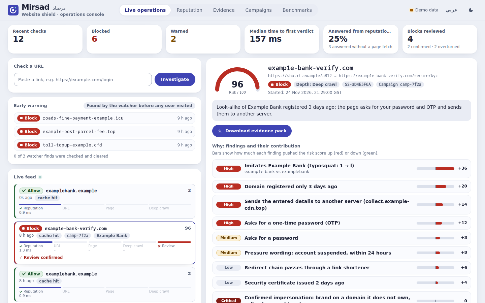
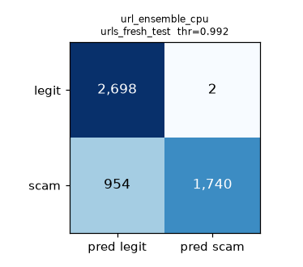
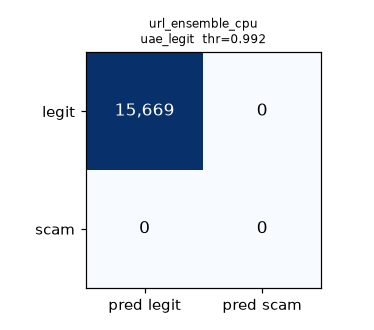
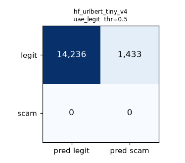
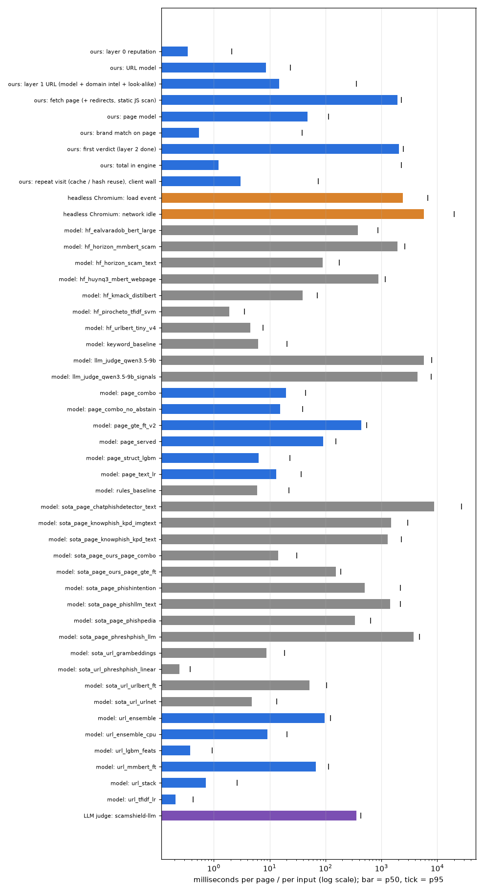

# Mirsad at the network: the website shield (مرصاد)

This is Mirsad's website shield, the part of Mirsad that works at the internet provider for people in the UAE: the first
time a phone opens a website, the network holds the connection for a moment, investigates the site with its own engine
(no browser), and then lets the page load or blocks it, with a risk score from 0 to 100 and reasons in Arabic and
English. Every block is re-checked by a second-opinion review and becomes an evidence pack an officer can use. It is a
hackathon prototype for the Abu Dhabi Police hackathon (the ScamShield AI Hackathon, 42 Abu Dhabi × Abu Dhabi Police)
by the Mirsad team, "Ctrl + Alt + Cats", not an official service. In the demo the internet provider is a Docker
container and the phone reaches it over a Tailscale (WireGuard) tunnel.



The operations dashboard during a demo run, on `uae-trafficfines-pay.com`, one of the simulated scam sites (a fake
traffic-fine payment page that exists only inside the demo network). The verdict is **BLOCK at risk 100**; each
finding shows the points it added (the page model, a request for card details, entered details sent to another server,
requests for an Emirates ID and a one-time password, a traffic-fine lure, pressure wording in English and Arabic).
Below them the second-opinion review confirms the block, and the Evidence panel shows the case reference and the live
capture beside the page "as seen by the engine".

## 1. Try it in two minutes

Requirements: Docker with Compose v2 on Linux or WSL2; the gateway needs `/dev/net/tun`. The engine runs on CPU. A GPU
is only needed for the optional local language model and page encoder (section 9). Commands run from `mirsad-gateway/`.

```bash
cp .env.example .env          # optional; TS_AUTHKEY=... skips the Tailscale login step
docker compose up -d --build  # engine (API + dashboard), watcher, gateway
curl localhost:8000/v1/health
```

The dashboard is **http://localhost:8000**: **Live** (verdicts as they land, with reasons and the review),
**Reputation** (one row per site the ISP has seen), **Evidence** (case files and downloads), **Campaigns** (linked scam
domains) and **Benchmarks**. The عربي button switches it to Arabic.

**See it work without a phone.** The phone simulator opens the sites in [`gateway/sim_urls.txt`](gateway/sim_urls.txt)
through the gateway:

```bash
docker compose --profile sim run --rm phone-sim
```

In our run it printed:

```
LOADED     4.4s  https://www.adpolice.gov.ae/  (HTTP 200, 62426 bytes)
LOADED     0.8s  https://www.example.com/  (HTTP 200, 577 bytes)
...
BLOCKED    0.0s  https://adpolice-fines-payment.com/  (connection refused by the gateway (ConnectError))
BLOCKED    0.0s  http://uaepass-verify-account.net/login  (block page shown)
BLOCKED    0.0s  https://tamm-abudhabi-refund.info/  (connection refused by the gateway (ConnectError))
```

The six simulated scam and clean sites of the live demo start with `docker compose --profile demo up -d`; the
three-minute script, the reset and the no-phone fallback are in [docs/DEMO.md](docs/DEMO.md).

**Check one URL:**

```bash
docker compose exec engine python -m scamshield check https://adpolice-fines-payment.com/
curl -s -X POST localhost:8000/v1/check -H 'Content-Type: application/json' \
     -d '{"url": "https://adpolice-fines-payment.com/", "depth": "page"}'
```

The running engine returned this on 25 Nov 2026, abridged. The domain does not resolve, so the verdict rests on the
domain and URL checks:

```
BLOCK   91.2/100  https://adpolice-fines-payment.com/   (stage: page)
  Blocked: likely scam (risk 91/100): Imitates Abu Dhabi Police (combosquat); Brand name "Abu Dhabi Police"
  stitched into an unrelated domain name; URL model: 86% likely a scam.
  محظور: احتيال محتمل (درجة الخطورة 91/100): ينتحل صفة شرطة أبوظبي (دمج الاسم بكلمات أخرى)؛ ...
    +30.6  [critical] domain.lookalike     Imitates Abu Dhabi Police (combosquat)
    +10.0  [medium  ] url.brand_in_domain  Brand name "Abu Dhabi Police" stitched into an unrelated domain name
     +5.5  [low     ] model.url            URL model: 86% likely a scam
     +5.0  [low     ] url.lure_keywords    Address contains lure words: "fines, payment"
     +4.0  [low     ] url.many_hyphens     Domain name stitched together with many hyphens
     +0.0  [info    ] page.unreachable     Page could not be fetched
```

`--depth` is one of `reputation | url | page | deep`; `--review` waits for the background crawl and the review of a
block; `--json` prints the full verdict. `check` on the command line starts an engine of its own, whose first call can
skip the URL model while it loads ("Check skipped: score_url unavailable"); the HTTP API uses the running engine.

**Optional: a real phone.** `docker compose logs -f gateway` prints `TAILSCALE LOGIN REQUIRED` and a URL; after sign-in
the container joins the tailnet as `scamshield-isp`. Approve it as an exit node in the Tailscale admin console
(**Edit route settings > Use as exit node**), then on the phone choose **Exit node > scamshield-isp** (on Android, turn
off *Allow LAN access* and set *Private DNS* to *Automatic* or *Off*). Every site the phone opens adds one JSON
`decision` line to `docker compose logs gateway`. The same-Wi-Fi WireGuard mode and troubleshooting are in
[gateway/README.md](gateway/README.md).

## 2. What it does

Every site gets one of three levels (thresholds in [`config.py`](src/scamshield/config.py)):

| Level | Risk | Plain HTTP, or HTTPS with the gateway's certificate | HTTPS without a certificate (the default) |
|---|---|---|---|
| **ALLOW** | below 35 | The page loads. | Passed through untouched. |
| **WARN** | 35–69 | A warning page with **Go back** / **Continue anyway**. | Passed through (`SCAMSHIELD_WARN_OVER_TLS=block` refuses it). |
| **BLOCK** | 70 or above | A bilingual block page: risk score, top reasons, case reference `SS-…`. | The connection is reset at once: Chrome shows its connection error, with no spinner and no timeout. |

- **Hold on the first visit.** An unknown site's connection is held while the engine investigates (at most
  `SCAMSHIELD_HOLD_S`, 8 s). Over plain HTTP the phone sees a short "checking this site" page when a decision takes
  longer than 1 s. Known, unchanged sites go straight through.
- **Revoke later.** After the user is let through, a deep crawl carries on in the background. A late finding cuts open
  connections and blocks the site from then on.
- **Unblock after review.** A block the second-opinion review overturns is allowed again within seconds.
- **`http://shield.test/`** is the phone's own protection page, served by the gateway: that phone's recent decisions,
  newest block first, with the risk score, the impersonated brand, the top reasons in English and Arabic and the case
  reference. It explains the bare connection errors of blocked HTTPS sites. It refreshes every 3 seconds.
- **Early warning.** A watcher finds look-alike sites before anyone visits them (section 3); the dashboard lists them.
- **Fail closed.** If the engine does not answer within the hold time, an unknown site is blocked
  (`SCAMSHIELD_ON_TIMEOUT=allow` fails open); sites already decided keep their last decision.

The gateway can also be used as an ordinary proxy: `curl -x http://localhost:8081 http://example.org/`.

## 3. How detection works

The engine (`src/scamshield/`) answers the gateway's `POST /v1/check` in layers, and stops as soon as one can decide:

| Layer | What it does | When the user waits for it |
|---|---|---|
| **0 · Reputation** | The engine's own per-host table: cached verdict, the page's fuzzy hashes, DNS addresses, network, name servers and certificate, plus the registry of official domains (every `*.gov.ae` and `*.mil.ae` host by a suffix rule) and pre-filled feed and popularity data. | Always (p50 0.26 ms) |
| **1 · URL** | URL model, fast domain intelligence (age, DNS), look-alike and brand checks: typosquats, homoglyphs, brand + lure word, brand in a subdomain. | When layer 0 cannot decide |
| **2 · First page** | Fetches the page and its immediate redirects as a phone would; static JavaScript analysis, page model, brand-impersonation and form checks, the cloaking comparison, the optional LLM page judge. | New, low-reputation or changed sites |
| **3 · Deep crawl** | Background crawl of the same site (up to 25 pages, 60 s budget) for the payment or credential page behind a clean landing page. A late finding **revokes** the allow; the decision is stored and survives a restart. | Never (after the answer) |
| **4 · Review** | Only after a block: re-tests each accusation against independently gathered facts and confirms, downgrades or **overturns** it (section 4). | Never (background) |

The score is a logistic squash of signed points ([`engine/rules.py`](src/scamshield/engine/rules.py), 80 kinds of
finding, each with English and Arabic titles). Hard guards sit on top: the URL model on its own never blocks, it only
triggers a deeper check; a verified official domain never goes above warn; an established domain is blocked only on a
critical finding or two independent high-severity findings; a confirmed brand impersonation that collects sensitive
data always blocks.

**The no-browser engine** ([`engine/fetch.py`](src/scamshield/engine/fetch.py)). The detection path never drives
Playwright, Selenium or an automated Chrome, so a site has no automation flags to look for:

- *It looks like a real phone*: `curl_cffi` with Chrome's TLS and HTTP/2 fingerprints, Chrome's headers in Chrome's
  order, an Accept-Language with `ar-AE`. It only sends GET requests and never submits a form. It resolves DNS itself,
  refuses private addresses and pins the vetted address against DNS rebinding.
- *It follows every redirect*: HTTP, `<meta refresh>`, JavaScript navigations found by static analysis, and 50 known
  URL shorteners, up to 10 hops, each recorded in the verdict.
- *It reads JavaScript without running it* ([`engine/jsanalysis.py`](src/scamshield/engine/jsanalysis.py)): scrambling
  (`eval`/`atob` chains, `_0x` identifiers, long blobs), where entered data is sent (form actions, `fetch`/XHR,
  Telegram-bot and Discord-webhook exfiltration), abusive behaviour (back-button traps, clipboard hijacking, wallet
  drainers) and cloaking gates. Deliberately scrambled first-party script on a low-reputation site is itself a
  high-severity finding. Script-injected forms and the data endpoints of client-rendered shells are reconstructed.
- *It compares views to find cloaking*: the site is fetched as a phone user arriving from Google, as a desktop user and
  as an obvious bot. A different real page for the bot is **cloaking**; a mere refusal or challenge is ordinary bot
  protection, which real banks use, and does not count.

**Models** (details and every slice in the linked benchmark documents):

| Model | Layer | What it is |
|---|---|---|
| **`url_ensemble_cpu`** (served) | 1 | Calibrated average of a CPU stack (character 1–5-gram TF-IDF → logistic regression → LightGBM over lexical and host features, isotonic calibration) and `jhu-clsp/mmBERT-small` fine-tuned on 2,043,477 URLs, exported as int8 ONNX. About 9 ms p50 per URL. Without the transformer files the engine serves the stack alone (`url_stack`, under 1 ms). |
| `page_combo` (CPU) | 2 | LightGBM over 125 structural and behavioural page features plus a TF-IDF text model. It reads the HTML as data, never renders it, and **abstains** on contentless pages. |
| **`page_served`** (served in our setup) | 2 | `page_combo` combined with `Alibaba-NLP/gte-multilingual-base` fine-tuned on our pages, pages our engine fetched live and 10.9k real Arabic scam and legitimate messages. Runs as a separate GPU service; it receives extracted text, never raw HTML, under a 1.2 s timeout with a circuit breaker. |
| Local LLM (`Qwen/Qwen3.5-9B` on vLLM) | 2, 4 | On the team's own GPU, no external AI API. It sees a distilled summary fenced as untrusted text. Measured as a stand-alone judge it ranks worse than the page model, so it only adds points and writes the review's explanation. |

**Reputation and when to investigate again.** A site is investigated when it is new, its reputation is low, or
something changed: the page's fuzzy content and structure hashes, its IP addresses and network, its name servers, its
certificate ([`engine/pipeline.py`](src/scamshield/engine/pipeline.py),
[`engine/store.py`](src/scamshield/engine/store.py)). The page hashes are 64-bit SimHashes over text shingles and over
DOM tag paths, with dates, tokens and random IDs stripped first
([`engine/hashing.py`](src/scamshield/engine/hashing.py)): two loads of the same page fall within 6 bits and reuse the
cached verdict; unrelated pages are about 32 bits apart; a change of 16 bits or more counts as changed content. Each
change is recorded with its kind and time, and the dashboard's Reputation tab shows it. Public feeds play no part in the
first-visit decision: they only pre-fill this table, so the engine knows which sites it can skip.

**Early detection** ([`src/scamshield/watch/`](src/scamshield/watch)). The watcher reads Certificate Transparency
logs directly, filters the daily WhoisDS list of newly registered domains for UAE lures, sweeps generated look-alikes of
every registry brand, extracts UAE phone numbers from pages, listings, search snippets and SMS (Arabic-Indic digits
too) and flags a number that is not on the claimed brand's official list, and optionally reads search results.
Candidates go into the reputation table and through the same engine. **Campaign linking** joins flagged domains that
share an exfiltration endpoint, a tracker ID, a certificate, a non-CDN IP, a name-server, registrar and
registration-window combination, a near-identical page hash or a fake phone number.

**No hardcoding.** The engine has no special case for demo sites, test sites or particular hostnames. Brands, official
domains, hosting platforms, TLDs, lure words and the review policy live in data files
([`src/scamshield/intel/data/`](src/scamshield/intel/data),
[`src/scamshield/review/data/policy.json`](src/scamshield/review/data/policy.json)); thresholds and weights live in
configuration.

**Speed.** On 95 live legitimate pages, one at a time, the user's wait on a first visit was 4.5 ms p50 and 2.3 s p95;
pages that needed a fetch took 2.1 s p50 for the whole verdict, where a headless Chromium needed 2.4 s to reach its
`load` event before any analysis (section 9).

## 4. When Mirsad is wrong: the second-opinion review

A wrong block must be found and lifted by facts, and a real scam must not talk its way out.

- **Every block (risk ≥ 70) is reviewed** in the background, in a median of about 3 s with rules alone and about 15 s
  with the local model. Blocks waiting for a review when the engine stopped are queued again on start.
- **Each accusation becomes a claim, tested against facts the review gathers itself**: the name the site gives itself
  against its domain; where its forms really send data; whether a redirect still leads to gambling or harmful content;
  registration, certificate and archive history; curated ownership records; blocklists.
- **An upheld claim confirms the block**, whatever the domain's age: a takeover is about what the site does now. A claim
  that could not be tested is not refuted, so the block stands (*inconclusive*).
- **Lifting a block needs independent positive evidence of legitimacy**; the absence of new bad evidence is never
  enough. An overturn needs evidence from records the site cannot write; page content adds at most 2 points, so a
  copied site cannot clear itself. A blocklisted site is at most downgraded. Thresholds:
  [`review/data/policy.json`](src/scamshield/review/data/policy.json).
- **The model cannot unblock on its own word**, and cannot block again a site the facts have cleared. It reads the
  tested claims and writes the explanation in English and Arabic.

Measured in both directions ([docs/BENCHMARKS_REVIEW.md](docs/BENCHMARKS_REVIEW.md);
`ml/results/review_*__listings_final_blocks.json`). The 56 final blocks of the Abu Dhabi listings scan (section 7) were
labelled by hand: 43 bad, 9 legitimate-looking, 4 unlabelled.

| Set | Judge | Real scams kept blocked | Legitimate blocks: allow / warn / still blocked | Median s |
|---|---|---|---|---:|
| 56 final listing blocks | rules | **43 of 43** | 0 / 3 / 6 of 9 | 3.1 |
| 56 final listing blocks | Qwen3.5-9B (live model) | **43 of 43** | 0 / 1 / 8 of 9 | 15.4 |
| 43 earlier listing blocks, all treated as legitimate | rules | — | 17 / 14 / 12 | 2.7 |
| 4 simulated demo scams | rules | 4 of 4 | — | 7.3 |

Read these honestly: no real scam was let through, but most of the legitimate-looking blocks that remain are
businesses listed on a public phishing feed, and the review will at most downgrade a blocklisted site. An earlier
version of the reviewer weakened takeover blocks; it was found by this measurement and fixed (a takeover claim is now
re-tested on what the site does today), and the rows measured before the fix are kept in the linked document.

## 5. What gets recorded as evidence

Nothing is sent anywhere automatically. Every block gets one case reference (`SS-` and the first 8 hex digits of the
verdict id,
[`evidence/reference.py`](src/scamshield/evidence/reference.py)), the same string on the phone's block page, in the
dashboard, in the report and in the zip's name. The evidence pack (`GET /v1/verdicts/{id}/evidence` or the dashboard's
Evidence tab; [`evidence/pack.py`](src/scamshield/evidence/pack.py)) holds:

| File | Content |
|---|---|
| `report.pdf`, `report.html` | Bilingual case report: verdict, risk score, reasons with their points, the review's conclusion |
| `screenshot.png`, `rendered_dom.html` | A capture taken after the verdict by a throwaway headless Chromium, never on the detection path |
| `capture.html` | The HTML exactly as the engine fetched it |
| `headers.json`, `verdict.json` | Response headers; the full verdict, including the redirect chain and timings |
| `registration_raw.json` | RDAP / WHOIS and hosting records |
| `takedown_request.txt`, `takedown_request_ar.txt` | An abuse report for the registrar, host or CDN, and an Arabic report for UAE authorities |
| `manifest.json` | SHA-256 of every file, and a note on anything that could not be collected |

Every timestamp is given in UTC and in Gulf Standard Time. The UAE reporting channels (Abu Dhabi Police Aman, Dubai
Police eCrime, the MOI platform, aeCERT/TDRA, the CBUAE) are listed in the report for an officer to use. Each reason
carries a code, a severity, its points and English and Arabic titles; model scores come with their top features (for
example *"title names a brand this domain does not belong to"*), and the dashboard shows the review step by step.

## 6. Privacy and safety

**What the gateway sees.** By default only hostnames: the name the phone resolves over DNS and the server name in the
TLS handshake. It holds or refuses connections and never decrypts traffic. Full URLs and block pages over HTTPS need
`SCAMSHIELD_INTERCEPT=1` and the gateway's CA installed on the phone, a deliberate step described in
[docs/DEMO.md](docs/DEMO.md) with how to undo it. Apps that pin their certificates and the hosts in
[`gateway/passthrough.txt`](gateway/passthrough.txt) are passed through untouched.

**What is stored**, in SQLite under `./data/` (git-ignored): one reputation row per hostname with its verdict, visit
counts and change history; verdicts; evidence packs. The phone's protection page is keyed by the phone's tailnet
address, so each phone sees only its own history. Investigating a site means fetching it and looking it up in public
records (RDAP, certificate logs, the Internet Archive, optionally search); the language model runs on the team's own
GPU, so no page or verdict goes to an external AI API.

**Safety of the agentic parts** ([docs/SECURITY_REVIEW.md](docs/SECURITY_REVIEW.md)). The engine reads hostile pages
and lets a language model reason about them, so both were attacked:

- *Prompt injection*: scam pages carried instructions to the reviewer in visible, hidden, comment, alt-text and Arabic
  form, plus fake tool results and budget-exhaustion lures. **0 of 12** scam pages, counting a control, were unblocked
  ([docs/BENCHMARKS_REVIEW.md](docs/BENCHMARKS_REVIEW.md)); the model itself proposed an unblock twice and the
  fact-based policy refused both.
- *Network escape*: no test request reached the private canary, through the review agent's fetches or the engine's
  fetcher, by redirects, meta refresh, JavaScript redirects, scripts, favicons or data endpoints.
- *Fixed*: the evidence browser can no longer reach private addresses; the block page escapes hostile URLs in a single
  pass; captured scam HTML is served sandboxed; the PDF renderer cannot fetch remote files; batch uploads are
  size-limited; model tool calls are restricted to the site under review and the claimed brand's official domains.

**Accepted for the demo:** the evidence browser runs inside the container without Chromium's own sandbox (it cannot
reach private addresses; `SCAMSHIELD_EVIDENCE_SCREENSHOT=0` turns it off); the API has no authentication and is meant
for one machine; a page with an explicit "note to the AI reviewer" keeps its block, even on a legitimate site.

## 7. Built for the UAE

- **Arabic everywhere**: the block, warning and "checking" pages on the phone, every reason, the dashboard (full
  right-to-left layout), the case report and the Arabic takedown text. Arabic is normalised (alef, ya and ta marbuta
  forms, tatweel, diacritics, Arabic-Indic digits) before the page model reads it.
- **UAE brand registry**: [`intel/data/brands.json`](src/scamshield/intel/data/brands.json) lists 154 brands commonly
  impersonated in the UAE (government services such as TAMM, UAE PASS, ICP, the police, RTA, Salik and Darb; banks;
  utilities; couriers; telecoms; airlines; events), each with English and Arabic names, official domains and official
  customer-care numbers.
- **Local lures** in the page model's English and Arabic lexicons (traffic fines, parcel fees, UAE PASS or Emirates ID
  OTP, account blocked), taken from the wording of police and press warnings
  ([`docs/research/uae_threat_landscape.md`](docs/research/uae_threat_landscape.md) §2, which also sources the threat
  figures behind this design).
- **Location advantage**: a gateway inside the UAE sees the page a victim in the UAE sees; commercial scanners rent
  proxy networks to get past geofenced scam kits ([`docs/research/industry.md`](docs/research/industry.md) §0).

**Case study: the websites of 8,883 Abu Dhabi business listings.** The engine checked every website linked from public
map listings of Abu Dhabi businesses. The listing file is private, so only aggregates are published, in
[`ml/results/listings_scan.json`](ml/results/listings_scan.json):

| Scan | Allow | Warn | Block | Flagged |
|---|---:|---:|---:|---:|
| First scan, before tuning | 7,696 | 982 | 205 | 13.4% |
| Final live scan, frozen engine | 8,505 | 322 | 56 | 4.3% |

Of the 56 final blocks, 43 lead to or serve gambling or other harmful content (business domains taken over: lapsed
names re-registered by someone else, or long-standing sites that now redirect to slot sites, for example
`magicano-uae[.]com`), so a customer who taps
the website link on a map listing lands on a gambling page; 8 are on a public phishing feed; 4 are young domains with
data-theft or wallet-draining scripts (not checked by hand); 1 is something else. Of the 322 warnings, 120 are expired
or parked, 4 are re-registered names that redirect elsewhere, and 198 (about 2.2% of the list) are other cases, mostly
model scores with a risky TLD, a site builder or a young domain. **These are development numbers**: rules were tuned on
this list after the first scan, and the two scans ran about three hours apart.

## 8. How it fits with the other parts of Mirsad

This repository holds three parts of Mirsad. Each one works where it can see the attempt:

| Part | Where it runs | What it sees | For whom |
|---|---|---|---|
| **The Mirsad portal** (repository root) | An officer's machine | Chats and Telegram conversations, citizen reports, the phone watchlist, the Abu Dhabi Places map of businesses with their websites and phones | Officers |
| **Mirsad Android** ([`../mirsad-android/`](../mirsad-android/README.md)) | The citizen's phone, with no internet permission | SMS, messaging-app notifications, calls | Citizens |
| **The website shield** (this folder, `mirsad-gateway/`) | The network, as a simulated internet provider | The websites a phone opens (hostnames; full URLs only with the gateway's certificate) | Subscribers; officers through its dashboard and evidence packs |

What links the website shield to the other parts today is files, not a live connection:

- **Evidence packs and takedown requests.** Each block's zip (section 5) and its takedown texts are ordinary files an
  officer downloads from the gateway's dashboard and keeps with the case. The portal has no upload for them yet: its
  case log records chats, captures, watchlist decisions and merchant confirmations.
- **The listings audit reads the portal's Places directory.** The portal's map loads a Places JSON built by
  `scripts/build-places-json.py` at the repository root (one record per business, with its websites and phones; a sample
  is in `fixtures/places/`). [`scripts/check_places_websites.py`](scripts/check_places_websites.py) reads the same
  format, checks each listed website with the gateway's engine (the kind of check behind the case study of section 7)
  and compares listings that carry a registry brand's name with that brand's official websites and phone numbers; the
  run and its output are described in [docs/PLACES_AUDIT.md](docs/PLACES_AUDIT.md).
- **Known-good numbers beside known-bad ones.** The portal's Phone watchlist holds numbers officers flagged, and Mirsad
  Android imports them as a signed blocklist. The gateway's brand registry holds the official customer-care numbers of
  154 brands, and its helpline check flags a page, listing or SMS that shows a number which is not the claimed brand's
  own. The two lists complement each other; nothing joins them today.

Not connected yet: the gateway does not send verdicts or evidence to the portal's API; the portal's watchlist and
Android's blocklist do not feed the gateway's reputation table; links found in citizen reports or on the phone are not
sent to the gateway for a check; the portal's **Check in Places** does not show the gateway's verdict for a listed
website. None of these bridges exists in the code today.

## 9. Build from source, tests, evaluation

Internal identifiers keep the working name `scamshield`, after the hackathon: the Python package, the CLI
(`python -m scamshield`), the `SCAMSHIELD_*` environment variables, the container and tailnet names.

```bash
python3 -m venv .venv && .venv/bin/pip install -e '.[dev]'
.venv/bin/python -m playwright install chromium-headless-shell   # only for evidence-pack screenshots
.venv/bin/python -m scamshield serve                              # API + dashboard on :8000
.venv/bin/python -m scamshield check https://example.com/
.venv/bin/pytest                                                  # 1,025 passed, 5 skipped (25 Nov 2026)
```

- The tests cover the engine, intel, pipeline, review, evidence, watcher and gateway; tests that need the internet are
  skipped. While the Docker stack runs, its SQLite database belongs to the container: run the host CLI with
  `SCAMSHIELD_DB=/tmp/scamshield-cli.db`.
- **Score a CSV of URLs** (for example a hidden test set): `python -m scamshield batch data/my_urls.csv -o
  data/verdicts.csv` inside the container (`./data` is mounted at `/app/data`), or `POST /v1/batch` with the CSV. One
  output row per input row, in order, with `decision`, `risk_score`, `label_pred`, the top reasons and timings; with a
  `label` column it also prints the confusion matrix, precision, recall and false-positive rate.
  `SCAMSHIELD_BLOCKLISTS=0` turns off feed lookups to measure only what the engine detects by itself.
- **The local language model**: set `SCAMSHIELD_LLM_BASE_URL` (any OpenAI-compatible server) and `SCAMSHIELD_LLM_MODEL`
  in `.env`. Without a model the review runs the same tools as a fixed checklist under the same policy.
- **The GPU page encoder** runs as a small service on port 8003
  ([`ml/serve/page_encoder_server.py`](ml/serve/page_encoder_server.py)); set `SCAMSHIELD_PAGE_ENCODER_URL` and restart
  the engine. Its weights (about 1.2 GB) are not in the repository; without it the engine uses `page_combo` alone.
- **Benchmarks** are generated from `ml/results/` by `ml/bench/` and `ml/sota/`. The API contract is in
  [docs/ARCHITECTURE.md](docs/ARCHITECTURE.md) and the design brief in [docs/REQUIREMENTS.md](docs/REQUIREMENTS.md).

**What this repository ships, and what it does not.** It ships our own verified UAE brand registry and the other
reference lists ([`src/scamshield/intel/data/`](src/scamshield/intel/data)), the trained model files in `ml/artifacts/`
(except the GPU page encoder), the training, benchmark and evaluation code, and the benchmark results as counts and
metrics. It does not ship data taken from third-party datasets or from our scans:

- **The global brand list** (`src/scamshield/intel/data/global_brands.json`), derived from the Phishpedia project's
  public domain map (Lin et al., USENIX Security 2021). Without it the engine matches the UAE registry only, so
  look-alikes of non-UAE brands are caught by the URL and page models and the other rules, but not by name. To use it,
  take the domain map from the Phishpedia repository and write it to that path as `{"brands": {name: [domains]}}`; no
  script in this repository builds it.
- **The datasets** behind the models and benchmarks (`ml/data/`, git-ignored): public phishing feeds, Hugging Face and
  Kaggle datasets, top-site lists, Common Crawl, PhreshPhish, KnowPhish, Mendeley and Phishpedia. Their builders and
  manifests are not in this repository either; the training and benchmark scripts under `ml/url/`, `ml/page/`,
  `ml/bench/` and `ml/sota/` read them from `ml/data/processed/`, `ml/page/crawl_legit.py` re-fetches the live
  legitimate pages, and `ml/sota/url/phreshphish_fetch.py` downloads the PhreshPhish split definitions.
- **The per-URL rows of the benchmark results** and **the recorded page snapshots** of real sites used by the
  false-positive regression tests (`tests/pipeline/snapshots/`, git-ignored). The tests skip without the snapshots; the
  test file's docstring shows the one command that records them with the engine's own fetcher.

The engine, the gateway and the test suite run without any of these.

**How the comparison is kept fair** ([docs/BENCHMARK_PROTOCOL.md](docs/BENCHMARK_PROTOCOL.md)). Every system is scored
on the same rows with the input it was designed for. Academic methods without released weights were **recreated** and
trained on exactly our training rows with the authors' hyper-parameters; public models are scored **as released** at
their own thresholds; no threshold was picked on a test set. Model benchmarks read frozen captures. URLs: 4,343,646 from
public feeds, datasets, top-site lists and Common Crawl, split by registered domain, newest phishing in test. Pages:
100,306 from PhreshPhish, KnowPhish, Mendeley and Phishpedia. PhreshPhish's official split is not domain-disjoint (68%
of its benign and 44% of its phishing test URLs share a registered domain with a training URL), which inflates URL-only
scores on it.

**False positives on real UAE sites** (official government, bank and utility URLs, none used in training; `uae_legit`,
15,669 URLs; [docs/BENCHMARKS.md](docs/BENCHMARKS.md)):

| System | Form | Flagged |
|---|---|---:|
| **url_ensemble_cpu (ours, served)** | trained on our data | **0** |
| url_stack (ours, CPU stack alone) | trained on our data | 0 |
| GramBeddings / URLBERT / URLNet | recreated, trained on our data | 6 / 8 / 21 |
| PhreshPhish linear baseline | recreated, trained on our data | 67 (0.43%) |
| hf_ealvaradob_bert_large | public, as released | 949 (6.06%) |
| hf_urlbert_tiny_v4 | public, as released | 1,433 (9.15%) |
| hf_kmack_distilbert | public, as released | 1,829 (11.67%) |
| hf_pirocheto_tfidf_svm | public, as released | 3,058 (19.52%) |

On 3,674 more UAE airline, retail, courier and telecom URLs (`uae_legit_v3_new`) the served model also flags 0, the
public models 70 to 717. The whole engine, all layers to page depth with blocklists off, blocked **0 of 400**
legitimate UAE and fresh-feed URLs and warned on 3 (`legit_uae_and_fresh_oddhalf`). On 516 legitimate pages the engine
fetched live (`live_legit_test`), the served page system flagged 3 (0.58%) and the CPU page model 0.

**URL layer.** ROC-AUC, recall at 1% FPR and FPR at each system's own threshold on the domain-split test set
(`urls_test`, 393,212 URLs; † = 10,000-row sample), then on the fresh 48-hour feed set that imitates the hidden test
(`urls_fresh_test`, 5,394 URLs):

| System | Form | ROC-AUC | R@1%FPR | FPR | Fresh ROC-AUC | Fresh R@1%FPR | p50 ms / URL |
|---|---|---:|---:|---:|---:|---:|---:|
| **url_ensemble_cpu** † | ours, served | 0.9826 | 0.8146 | 0.02% | 0.9914 | 0.8775 | 9.2 |
| url_mmbert_ft | ours, GPU, not served | **0.9836** | **0.8185** | 0.09% | **0.9917** | **0.8898** | 67.6 (GPU) |
| url_stack | ours, CPU stack alone | 0.9768 | 0.7644 | 0.06% | 0.9876 | 0.8241 | 0.72 |
| GramBeddings | recreated | 0.9758 | 0.7502 | 0.09% | 0.9880 | 0.8200 | 8.7 |
| URLNet | recreated | 0.9715 | 0.7221 | 0.15% | 0.9874 | 0.8281 | 4.8 |
| URLBERT | recreated (0.35 epochs) | 0.9573 | 0.6242 | 0.09% | 0.9777 | 0.7365 | 51.7 |
| PhreshPhish linear | recreated (URL only) | 0.9532 | 0.6105 | 0.13% | 0.9674 | 0.6485 | 0.24 |
| hf_kmack_distilbert | public, as released | 0.9498 | 0.4733 | 23.40% | 0.9392 | 0.3523 | 39.0 |
| hf_urlbert_tiny_v4 | public, as released | 0.9395 | 0.3858 | 19.06% | 0.9399 | 0.4250 | 4.5 |
| hf_ealvaradob_bert_large | public, as released | 0.9302 | 0.1386 | 21.39% | 0.9183 | 0.1047 | 380 |

Against methods retrained on the same data the lead is modest: GramBeddings, recreated, catches more phishing than our
CPU stack at its operating point (recall 0.539 vs 0.482) and is level on ROC-AUC. Against models a deployer can download
today the gap is large: they flag 19–24% of legitimate test URLs and 6–20% of official UAE URLs.

<p>



</p>

**Page layer** on the fresh, domain-disjoint page test set (`pages_test`, 15,048 pages, 49% scam;
[docs/BENCHMARKS_PAGE.md](docs/BENCHMARKS_PAGE.md)):

| System | Form | Precision | Recall | FPR | ROC-AUC | R@1%FPR | p50 / page |
|---|---|---:|---:|---:|---:|---:|---:|
| **page_served** | ours, served (CPU + GPU encoder) | 0.993 | **0.820** | 0.61% | **0.987** | **0.856** | 90 ms |
| page_combo | ours, CPU alone | 0.988 | 0.385 | 0.48% | 0.855 | 0.464 | 20 ms |
| hf_ealvaradob_bert_large | public, as released | 0.578 | 0.482 | 36.82% | 0.560 | 0.013 | 3.7 s |
| hf_huynq3_mbert_webpage | public, as released | 0.526 | 0.593 | 55.74% | 0.543 | 0.024 | 0.9 s |
| hf_horizon_mmbert_scam | public, as released | 0.517 | 0.751 | 73.17% | 0.516 | 0.009 | 1.9 s |

Visual and LLM-based academic methods on 600-page balanced samples
([docs/BENCHMARK_PROTOCOL.md](docs/BENCHMARK_PROTOCOL.md), "Results"). The LLM methods use our local 9B model where
the papers used GPT-3.5, GPT-4V or Gemini, so they are weaker here than in their papers:

| Method | Form | Sample | Precision | Recall | FPR | ROC-AUC |
|---|---|---|---:|---:|---:|---:|
| Phishpedia | as released (code + weights) | KnowPhish TR-OP | 0.989 | 0.303 | 0.3% | 0.733 |
| PhishIntention | official code, no live step | KnowPhish TR-OP | 1.000 | 0.283 | 0.0% | 0.642 |
| KnowPhish detector (logo + text) | recreated | KnowPhish TR-OP | 1.000 | 0.427 | 0.0% | 0.789 |
| PhishLLM (text) | recreated | KnowPhish TR-OP | 0.926 | 0.627 | 5.0% | 0.859 |
| ChatPhishDetector (text) | recreated | KnowPhish TR-OP | 0.806 | 0.900 | 21.7% | 0.897 |
| page_combo, never trained on TR-OP | ours | all 9,921 TR-OP pages | 0.969 | 0.839 | 2.7% | 0.941 |
| PhreshPhish LLM prompt | recreated | PhreshPhish test | 0.751 | 0.753 | 25.0% | 0.759 |
| ChatPhishDetector (text) | recreated | PhreshPhish test | 0.670 | 0.723 | 35.7% | 0.753 |
| page_combo | ours, CPU | PhreshPhish test | 1.000 | 0.330 | 0.0% | 0.868 |
| page_gte_ft | ours, GPU encoder | PhreshPhish test | 0.988 | 0.810 | 1.0% | 0.990 |

On the 45 Arabic test pages the served system has recall 0.962 with no false positives (`pages_test_arabic`); on 208
Arabic or Gulf-relevant pages the encoder lifts recall from 0.260 to 0.699, again with none (`pages_test_arabic_gulf`).
Our local LLM alone, on 300 balanced test pages, reached recall 0.487 at **5.3% FPR**, against 0.387 at 0% for
`page_combo` on the same rows: that is why it never decides alone.

**Speed per page**, 95 live legitimate pages (news, banks, government, Arabic sites, JavaScript apps), one at a time, on
a quiet machine ([docs/BENCHMARKS.md](docs/BENCHMARKS.md), "Speed per page", run of 25 Nov 02:50; raw data in
[`ml/results/page_speed/page_speed.json`](ml/results/page_speed/page_speed.json)):

| Step | p50 | p95 |
|---|---:|---:|
| **User's wait on a first visit, all 95 pages** | **4.5 ms** | 2.3 s |
| … sites answered from the reputation table (61 pages) | 3.4 ms | 11.0 ms |
| … sites settled at the URL layer (17 pages) | 276 ms | 462 ms |
| … sites that needed a page fetch (17 pages) | 2.1 s | 2.6 s |
| **Repeat visit, all 95 pages** | **3.0 ms** | 74 ms |
| Our fetch of a page (redirects + static JS scan) | 1.9 s | 2.3 s |
| Headless Chromium, `load` event (88 pages, 7 failed) | 2.4 s | 6.8 s |
| Headless Chromium, network idle (24 pages never idle, capped at 20 s) | 5.8 s | ≥ 20 s |

Published per-page times of other systems: Phishpedia 0.19 s plus 1.88 s for the screenshot, KnowPhish 2.02 s, PhishLLM
3.2 s, DynaPhish 10.9 s, a GPT-4V agent about 20 s (BENCHMARKS.md, "Reported by the authors").



**Folder layout:** `src/scamshield/` (engine, intel, models, review, watch, evidence, api), `gateway/` (the simulated
ISP: Tailscale exit node, mitmproxy addon, hold and block pages, phone simulator), `dashboard/` (operations console),
`demo/` (simulated sites, private Docker network only), `ml/` (training, benchmarks, results), `docs/` (architecture,
requirements, demo runbook, benchmarks, security review, [research](docs/research)), `tests/`. Design decisions are in
[DECISIONS.md](DECISIONS.md) and the state of the work in [STATUS.md](STATUS.md).

**Real and fictitious data in this folder.** The website shield cannot be wholly synthetic, as the rest of this
repository aims to be. It ships a reference registry of the real official domains and customer-care phone numbers of UAE
organisations ([`src/scamshield/intel/data/`](src/scamshield/intel/data)), because recognising the real ones is how it
avoids flagging them; a few tests name real public sites as must-not-flag cases (the recorded copies of their pages
are not in the repository, see above); and the simulated demo sites use fictitious hostnames, checked to be
unregistered when chosen, that resolve only inside the demo network. Benchmark results are published as counts and
metrics, and the Abu Dhabi listings scan only as aggregates.

## 10. Known limits and next steps

Detection limits:

- **End-to-end recall on live phishing-feed URLs was not measured on a reserved set.** The whole engine was measured on
  legitimate URLs (0 of 400 blocked); detection on scam pages is measured layer by layer, on stored data.
- **Some real local businesses still get a warning**: about 2.2% of the 8,883 listed websites, not explained by an
  expired or parked domain (development numbers).
- **Feed listings outweigh the review**: of the 9 legitimate-looking final blocks, mostly feed-listed businesses, the
  review keeps 6 blocked with rules and 8 with the model.
- **The URL model is triage, not a verdict**: it cannot see shortener targets, free-hosting pages or compromised
  legitimate sites, so those go to the page check. Its lead over recreated academic URL methods is modest, and with a
  whole source held out of training the CPU stack's recall drops (for example from 0.35 to 0.21 on one scam list).
- **Arabic page data is scarce**: 45 real Arabic test pages; the 297-page UAE scenario set is synthetic and reported
  separately. Labels are feed labels, and the fresh test set covers a single day of feeds.
- **`.ae` registration dates are unavailable** through the lookups used, so "young domain" evidence is missing for `.ae`
  sites and the review relies on certificate and archive history.
- **Static analysis has a ceiling**: a page that builds everything at run time can hide its final form; the shell, the
  scrambled scripts and the cloaking gates are scored instead, and the deep crawl and the review take a second look.
- **External lookups can fail**: the failure is recorded and the verdict carries on; a review that cannot gather enough
  facts ends *inconclusive*, and the block stands.

Network and deployment limits:

- **An ISP sees hostnames, not pages, unless it intercepts.** Without the certificate a blocked HTTPS site gets a
  connection error rather than the block page (`shield.test` explains why). A fixed Private DNS provider or another VPN
  on the phone bypasses the gateway.
- **The phone path over Tailscale has been exercised with the simulator, not yet with a physical phone.**
- **The first visit to an unknown site waits**: about 2.1 s (p50) when the page must be fetched; after 8 s without an
  answer the site is blocked.
- **Prototype scope**: one SQLite database and one engine process, no API authentication, the evidence browser without
  its own sandbox; scale and bypass hardening are out of scope ([docs/REQUIREMENTS.md](docs/REQUIREMENTS.md), R29).

Next steps, along the route that already exists in the UAE (under TDRA's Internet Access Management policy e& and du
block the content TDRA flags; [`docs/research/industry.md`](docs/research/industry.md) §2):

1. **Shadow mode**: run the engine on a copy of DNS or SNI logs at one ISP, or on the police's reported-URL queue; score
   and log only, and measure precision and recall against later reports with the `batch` command.
2. **Analyst desk**: officers check each evidence pack and send the police report and the TDRA / aeCERT block request
   themselves; takedown requests go out under their authority.
3. **Opt-in protection** for subscribers or government devices through the ISP's resolver or secure web gateway,
   warning first and blocking once the measured false-positive rate on real UAE sites is acceptable.
4. **A national feed** of confirmed blocks and linked campaigns for TDRA and the ISPs, and the file bridges of section 8
   (evidence into the portal, watchlist into the reputation table) built as APIs.

## 11. ملخص بالعربية

درع المواقع في مرصاد يعمل لدى مزوّد خدمة الإنترنت، ويحمي الناس في الإمارات من مواقع الاحتيال.
هو نموذج أولي لهاكاثون شرطة أبوظبي من فريق مرصاد (Ctrl + Alt + Cats)، وليس خدمة رسمية.
عندما يفتح الهاتف موقعاً للمرة الأولى، تُمسك البوابة الاتصال لحظات، ويفحص محرّكنا الموقع دون أي متصفح آلي، ثم يُفتح الموقع أو يُحظر.
ثلاثة مستويات: سماح (تُفتح الصفحة)، تحذير (صفحة تنبيه مع «رجوع» أو «متابعة»)، حظر (صفحة حظر بالعربية والإنجليزية أو قطع الاتصال فوراً)، مع درجة خطورة من 0 إلى 100 وأسباب واضحة.
يتتبّع المحرّك كل تحويل، ويقرأ شيفرة JavaScript دون تشغيلها، ويقارن ما يُعرض على الهاتف وما يُعرض على برامج الفحص لكشف الإخفاء.
بعد السماح يستمر الفحص في الخلفية، وقد يُلغي السماح إذا ظهر دليل متأخر؛ ولا يُعاد فحص موقع معروف لم يتغيّر.
كل حظر تراجعه مراجعة ثانية تجمع الحقائق بنفسها، فترفع الحظر الخاطئ؛ ولا يستطيع النموذج اللغوي رفع الحظر بكلمته وحدها.
في القياس بقيت المواقع الاحتيالية الثلاثة والأربعون محظورة كلها، مع الحكم بالقواعد ومع النموذج.
كل حظر يصبح ملف أدلة: تقرير بالعربية والإنجليزية، ولقطة الصفحة، وسجلات التسجيل والاستضافة، وطلب إزالة، وبصمات SHA-256؛ ولا يُرسل شيء تلقائياً.
لا ترى البوابة إلا أسماء المواقع ما لم تُثبَّت شهادتها على الهاتف، ويعمل النموذج اللغوي على أجهزتنا دون أي خدمة ذكاء اصطناعي خارجية.
يعرف مرصاد 154 جهة تُنتحل صفتها في الإمارات بأسمائها العربية ونطاقاتها وأرقامها الرسمية، فيكشف الرقم المزيّف في صفحة أو إعلان.
جرّبه في دقيقتين: ‎`docker compose up -d --build`‎ ثم افتح لوحة المتابعة على المنفذ 8000.
